# Proposta Arquitetural de Modelagem Dimensional: Constelação de Fatos e Views Analíticas do Projeto Adito

**Documento:** Proposta Técnica e Arquitetural de Tabelas/Views Fato  
**Projeto:** Adito — Sistema Integrado de Inteligência em Pesquisa, Extensão e Gestão  
**Destino de Implementação:** Oráculo (`Adito/app`) — Contexto Analítico Text-to-SQL  
**Data:** 12 de Novembro de 2026  
**Status:** DRAFT ALINHADO AO DDL ATUAL DA DEVELOPMENT (Sob Revisão & Ajuste)  
**Autor:** Arquiteto de Dados e Engenheiro de Analytics Sênior  

---

## 1. Resumo Executivo e Visão Geral da Arquitetura

### 1.1 Panorama do Problema e Abordagem Dimensional
O projeto **Adito** unifica quatro ecossistemas acadêmicos e administrativos do Instituto Federal do Espírito Santo (Ifes):
1. **SRC (Extensão):** Ações, programas, cursos, eventos, projetos de extensão, participantes e certificados.
2. **CNPq DGP (Diretório de Grupos de Pesquisa):** Grupos certificados, líderes, pesquisadores, estudantes, técnicos e linhas de pesquisa.
3. **SigPesq (Pesquisa e Bolsas):** Projetos de pesquisa, planos de trabalho, editais, bolsas de iniciação científica/tecnológica (PIBIC, PIBITI, PIBIC-Jr, etc.).
4. **Lattes (Currículos e Produção Intelectual):** Artigos, trabalhos em congressos, livros, capítulos, softwares, patentes, bancas e orientações.

O banco de dados relacional (PostgreSQL) encontra-se modelado em **3ª Forma Normal (3FN)** dentro do schema `unificado` (definido em `Adito/scripts/sql/`). Embora o modelo 3FN garanta integridade referencial e elimine anomalias transacionais, ele impõe uma complexidade proibitiva para agentes de BI orientados a LLM (Text-to-SQL / Oráculo):
- Consultas analíticas simples exigiriam JOINs de 8 a 15 tabelas, incluindo superclasses com herança (`iniciativa`, `pessoa`, `producao`, `membro_grupo`), tabelas associativas e tabelas de junção puras N:N (`acao_campus`, `fomento_acao`, `parceria_grupo`, `autoria_producao`).
- Modelos LLM frequentemente falham ao navegar por esquemas 3FN complexos, alucinando condições de junção, gerando produtos cartesianos (*chasm traps / fan-out traps*) ou aplicando agregações incorretas em métricas aditivas.

Para resolver essa dor estrutural sem violar a normalização transacional, adotou-se o padrão consagrado de **Views Analíticas Desnormalizadas (`vfact_*_resolved`)**, espelhado na view de referência `vfactvendasresolved` presente em `Adito/app/contexts/exemplo-vendas/`.

```text
┌─────────────────────────────────────────────────────────────────────────────┐
│                       CAMADA DE ARMAZENAMENTO (OLTP)                         │
│             PostgreSQL Schema 'unificado' (3FN - Integridade Total)          │
│  [iniciativa] ─── [acao] ─── [atividade] ─── [projeto_pesquisa] ─── [...]   │
└──────────────────────────────────────┬──────────────────────────────────────┘
                                       │
                                       ▼ JOINs Resolvidos & Nomes Amigáveis
┌─────────────────────────────────────────────────────────────────────────────┐
│                    CAMADA SEMÂNTICA / ANALYTICS (KIMBALL)                    │
│                 Views Desnormalizadas (vfact_*_resolved)                     │
│  • vfact_extensao_acao_resolved          • vfact_orientacao_bolsa_resolved   │
│  • vfact_extensao_participacao_resolved  • vfact_producao_cientifica_resolved│
│  • vfact_projeto_pesquisa_resolved       • vfact_grupo_pesquisa_membro_res.  │
└──────────────────────────────────────┬──────────────────────────────────────┘
                                       │
                                       ▼ Metadados, Embeddings e Few-Shot Rules
┌─────────────────────────────────────────────────────────────────────────────┐
│                          ORÁCULO TEXT-TO-SQL (LLM)                          │
│  1. Roteamento de Intenção no Contexto Único 'adito-analytics' (views.json) │
│  2. Geração de SQL analítico determinístico (Sem JOINs externos)            │
│  3. Retorno rápido ao usuário / Dashboards da Diretoria e Laboratórios      │
└─────────────────────────────────────────────────────────────────────────────┘
```

### 1.2 Diagrama Mermaid da Constelação de Fatos e Dimensões Conformadas

A arquitetura adota a metodologia de **Kimball Fact Constellation (Constelação de Fatos)**, na qual processos de negócio discretos possuem suas próprias views de fatos com granulações estritas, interligadas por **Dimensões Conformadas Compartilhadas**.

```mermaid
classDiagram
    %% Dimensões Conformadas Compartilhadas
    class DIM_TEMPO {
        +INTEGER ano
        +DATE data_evento
        +INTEGER mes
    }
    class DIM_CAMPUS_ORGANIZACAO {
        +BIGINT id_organizacao
        +TEXT campus
        +TEXT tipo_organizacao
    }
    class DIM_PESSOA {
        +BIGINT id_pessoa
        +TEXT nome_pessoa
        +TEXT titulacao
        +TEXT vinculo_categoria
    }
    class DIM_AREA_CONHECIMENTO {
        +BIGINT id_area
        +TEXT grande_area
        +TEXT area_conhecimento
        +TEXT subarea
    }
    class DIM_FOMENTO_PROGRAMA {
        +BIGINT id_programa
        +TEXT programa_fomento
        +TEXT edital_titulo
        +TEXT agencia_financiadora
    }

    %% Views Fato
    class VFACT_EXTENSAO_ACAO {
        <<Fact View - Grain: 1 Ação de Extensão>>
        +id_acao : PK
        +processo : TEXT
        +tipo_acao : TEXT
        +natureza : TEXT
        +relatorio_aprovado : BOOLEAN
        +m_qtd_acoes : INTEGER (=1)
        +m_qtd_atividades_vinculadas : INTEGER
    }

    class VFACT_EXTENSAO_PARTICIPACAO {
        <<Fact View - Grain: 1 Participação em Atividade>>
        +id_participante : PK
        +tipo_atividade : TEXT
        +situacao_participante : TEXT
        +m_carga_horaria : NUMERIC
        +m_flag_certificado : INTEGER
        +m_qtd_participantes : INTEGER (=1)
    }

    class VFACT_PROJETO_PESQUISA {
        <<Fact View - Grain: 1 Projeto de Pesquisa>>
        +id_projeto : PK
        +natureza_projeto : TEXT
        +parecer_diretoria : TEXT
        +sigilo : BOOLEAN
        +m_qtd_projetos : INTEGER (=1)
        +m_qtd_planos_trabalho : INTEGER
    }

    class VFACT_ORIENTACAO_BOLSA {
        <<Fact View - Grain: 1 Concessão de Bolsa/Orientação>>
        +id_orientacao : PK
        +modalidade : TEXT
        +gerenciamento : TEXT
        +m_valor_bolsa : NUMERIC
        +m_duracao_meses : INTEGER
        +m_flag_cancelado : INTEGER
        +m_flag_relatorio_enviado : INTEGER
        +m_qtd_orientacoes : INTEGER (=1)
    }

    class VFACT_PRODUCAO_CIENTIFICA {
        <<Fact View - Grain: 1 Autoria de Produção Intelectual>>
        +id_autoria_producao : PK
        +tipo_macro_producao : TEXT
        +subtipo_especifico : TEXT
        +titulo_producao : TEXT
        +veiculo_publicacao : TEXT
        +m_qtd_producoes : INTEGER (=1)
    }

    class VFACT_GRUPO_PESQUISA_MEMBRO {
        <<Fact View - Grain: 1 Vínculo de Membro em Grupo CNPq>>
        +id_membro_grupo : PK
        +nome_grupo : TEXT
        +situacao_grupo : TEXT
        +papel_membro : TEXT
        +status_participacao : TEXT
        +m_qtd_membros : INTEGER (=1)
        +m_tempo_participacao_dias : INTEGER
    }

    %% Conexões com Dimensões Conformadas
    DIM_TEMPO <|.. VFACT_EXTENSAO_ACAO
    DIM_CAMPUS_ORGANIZACAO <|.. VFACT_EXTENSAO_ACAO
    DIM_PESSOA <|.. VFACT_EXTENSAO_ACAO : Coordenador
    DIM_AREA_CONHECIMENTO <|.. VFACT_EXTENSAO_ACAO

    DIM_TEMPO <|.. VFACT_EXTENSAO_PARTICIPACAO
    DIM_CAMPUS_ORGANIZACAO <|.. VFACT_EXTENSAO_PARTICIPACAO
    DIM_PESSOA <|.. VFACT_EXTENSAO_PARTICIPACAO : Participante

    DIM_TEMPO <|.. VFACT_PROJETO_PESQUISA
    DIM_CAMPUS_ORGANIZACAO <|.. VFACT_PROJETO_PESQUISA
    DIM_PESSOA <|.. VFACT_PROJETO_PESQUISA : Coordenador
    DIM_AREA_CONHECIMENTO <|.. VFACT_PROJETO_PESQUISA

    DIM_TEMPO <|.. VFACT_ORIENTACAO_BOLSA
    DIM_CAMPUS_ORGANIZACAO <|.. VFACT_ORIENTACAO_BOLSA
    DIM_PESSOA <|.. VFACT_ORIENTACAO_BOLSA : Orientador / Orientado
    DIM_AREA_CONHECIMENTO <|.. VFACT_ORIENTACAO_BOLSA
    DIM_FOMENTO_PROGRAMA <|.. VFACT_ORIENTACAO_BOLSA

    DIM_TEMPO <|.. VFACT_PRODUCAO_CIENTIFICA
    DIM_CAMPUS_ORGANIZACAO <|.. VFACT_PRODUCAO_CIENTIFICA : Instituição
    DIM_PESSOA <|.. VFACT_PRODUCAO_CIENTIFICA : Autor
    DIM_AREA_CONHECIMENTO <|.. VFACT_PRODUCAO_CIENTIFICA

    DIM_TEMPO <|.. VFACT_GRUPO_PESQUISA_MEMBRO
    DIM_CAMPUS_ORGANIZACAO <|.. VFACT_GRUPO_PESQUISA_MEMBRO
    DIM_PESSOA <|.. VFACT_GRUPO_PESQUISA_MEMBRO : Pesquisador/Estudante
    DIM_AREA_CONHECIMENTO <|.. VFACT_GRUPO_PESQUISA_MEMBRO
```



---

## 2. Estudo de Viabilidade: Fato Universal vs. Constelação de Fatos

### 2.1 A Hipótese da "Fato Universal Única"
Uma tentação frequente em projetos de BI orientados a LLM é criar uma única view analítica universal — aqui denominada hipoteticamente de `vfact_iniciativa_ou_interacao_universal` — sob o pretexto de simplificar a seleção para o modelo de linguagem, que consultaria sempre a mesma tabela independentemente da pergunta.

Sob essa hipótese, tentar-se-ia unificar:
- Ações de Extensão (SRC)
- Projetos de Pesquisa (SigPesq / Lattes)
- Concessões de Bolsas e Orientações (SigPesq)
- Produções Bibliográficas, Técnicas e Patentes (Lattes)
- Participações em Grupos do CNPq

### 2.2 Análise Comparativa e Riscos Técnicos

| Critério de Análise | Hipótese: Fato Universal Única | Proposta Adotada: Constelação de Fatos Conformes |
|---|---|---|
| **Definição de Granularidade (Grão)** | **Conflitante e ambígua.** Uma linha representaria ora uma ação de extensão de 1 ano, ora uma concessão de bolsa mensal de R$ 700, ora a publicação de um artigo por 4 autores, ora um aluno que assistiu a uma palestra de 4 horas. | **Clara, rigorosa e atômica.** Cada view possui um grão explícito correspondente a um único evento transacional de negócio. |
| **Densidade de Dados (Esparsidade)** | **Extremamente esparsa (> 75% NULLs).** Artigos não têm `valor_bolsa`, `carga_horaria` ou `campus`; palestras de extensão não têm `doi`, `issn` ou `edital_pibic`. | **Densa e coesa.** Quase todos os atributos são preenchidos ou semanticamente relevantes para o evento em questão. |
| **Integridade de Métricas (Aditividade)** | **Alto risco de agregação falsa (*Fan-Out & Chasm Traps*).** Um `SUM(valor_bolsa)` em uma tabela mista geraria duplicações caso a linha representasse participantes de projeto, ou distorções no cálculo de médias (`AVG`) devido à presença de zeros e nulos. | **Métricas 100% confiáveis.** Agregações aditivas (`SUM`, `COUNT`, `AVG`) operam apenas sobre a população elegível ao indicador. |
| **Comportamento do Agente Text-to-SQL (LLM)** | **Alta taxa de erro e alucinação.** Tabelas com 60+ colunas semi-vazias confundem o prompt do LLM. O modelo erra filtros (`WHERE tipo_evento = 'extensao' AND doi IS NULL`), projeta colunas de contextos errados e erra os agrupamentos. | **Precisão máxima no SQL gerado.** Views especializadas com 15 a 25 colunas coesas. O LLM formula queries diretas (`SELECT campus, SUM(valor_bolsa) FROM vfact_orientacao_bolsa_resolved GROUP BY campus`). |
| **Custo de Processamento (Views SQL)** | **JOINs caríssimos e lentos.** O PostgreSQL precisaria executar FULL OUTER JOINs massivos entre todas as tabelas do schema `unificado`, sobrecarregando o planejador de consultas. | **JOINs direcionados e performáticos.** Cada view executa apenas os INNER e LEFT JOINs estritamente necessários ao seu domínio. |

### 2.3 Decisão Arquitetural Justificada
**Rejeita-se formalmente a hipótese da Fato Universal Única.**  
Adota-se a **Constelação de Fatos Conformes (Kimball)** composta por **6 Views Analíticas Principais**. O desafio de seleção de tabela é transferido para o **Roteador Semântico do Oráculo** (`views.json` com `description`, `embed_columns` e regras de desambiguação em `rules.md`), onde o processamento semântico de linguagem natural atua com 100% de precisão antes da geração do SQL.

---

## 3. Catálogo Detalhado de Cada View Fato Proposta (`vfact_*_resolved`)

---

### 3.1 `vfact_extensao_acao_resolved`

#### 1. Nome da Fato e da View
- **Nome Lógico:** Fato Ação de Extensão
- **Nome da View:** `unificado.vfact_extensao_acao_resolved`

#### 2. Evento de Negócio e Granularidade (Grão)
- **Evento de Negócio:** O registro, aprovação e execução de uma Ação Institucional de Extensão ou Ensino no SRC.
- **Grão (Uma linha representa):** Exatamente **uma ação de extensão** cadastrada no SRC, com seus metadados administrativos, classificação temática, campus de execução e coordenador responsável.

#### 3. Fontes de Dados Contempladas
- **Origem:** SRC (`src.ifes.edu.br`).
- **Tabelas do schema `unificado` envolvidas:**
  - `unificado.acao` (tabela base)
  - `unificado.iniciativa` (superclasse com título/nome)
  - `unificado.tipo_acao` (Programa, Projeto, Curso, Evento, Prestação de Serviço, Produto)
  - `unificado.natureza` (Extensão, Ensino, etc.)
  - `unificado.area_conhecimento` e `unificado.grande_area`
  - `unificado.pessoa` (coordenador da ação)
  - `unificado.acao_campus` e `unificado.organizacao` (campus onde a ação ocorre)
  - `unificado.fomento_acao` e `unificado.organizacao` (agência ou órgão de fomento)

#### 4. Dimensões e Atributos de Filtro/Agrupamento
- `id_acao` (Identificador único da ação)
- `titulo_acao` (Nome da iniciativa de extensão)
- `processo` (Número do processo administrativo no Ifes)
- `tipo_acao` (Ex: 'Projeto', 'Programa', 'Curso', 'Evento', 'Prestação de Serviço')
- `natureza` (Ex: 'Extensão', 'Ensino')
- `ano_cadastro` (Ano extraído de `data_cadastro`)
- `data_cadastro` (Data do registro)
- `relatorio_aprovado` (Booleano: TRUE / FALSE)
- `campus` (Nome do campus executor, ex: 'Campus Serra', 'Campus Vitória')
- `grande_area` (Ex: 'CIENCIAS_EXATAS_E_DA_TERRA', 'LINGUISTICA_LETRAS_E_ARTES')
- `area_conhecimento` (Ex: 'Ciência da Computação', 'Engenharia Elétrica')
- `coordenador_nome` (Nome do servidor coordenador da ação)
- `orgao_fomento` (Nome da organização financiadora, se houver)

#### 5. Métricas (Atributos Numéricos Aditivos / Semi-aditivos)
- `qtd_acoes`: Constante numérica `1` por linha (permite `SUM(qtd_acoes)` ou `COUNT(id_acao)`).
- `flag_relatorio_aprovado`: Inteiro `1` se aprovado, `0` se não aprovado.
- `qtd_atividades_vinculadas`: Subquery agregada com total de atividades cadastradas sob esta ação.

#### 6. Mapeamento ao Site Master (`https://ifesserra-lab.github.io/`)
- **Painel SRC (`/src/`):** Atende diretamente a "Evolução Histórica das Ações", "Distribuição por Tipo de Ação" (Projetos vs Cursos vs Eventos), "Ações por Área Temática / Grande Área" e "Ranking de Coordenadores".
- **Painel da Diretoria (`/diretoria/`):** Atende aos indicadores macro de "Total de Ações de Extensão por Campus" e "Índice de Relatórios Finais Aprovados".

#### 7. Exemplos de Perguntas do Usuário
1. *"Quantas ações de extensão foram cadastradas no campus Serra em 2024?"*
2. *"Qual o tipo de ação de extensão mais frequente (curso, evento ou projeto) no campus Vitória?"*
3. *"Quais são os 5 coordenadores que mais aprovaram relatórios de projetos de extensão?"*
4. *"Quantas ações de extensão foram realizadas na grande área de Engenharias nos últimos 3 anos?"*
5. *"Qual a porcentagem de ações de extensão com relatório final aprovado em 2023?"*

#### 8. Roteamento Semântico para o Oráculo
- **Gatilhos / Intenções:** Perguntas mencionando "ação de extensão", "projetos de extensão", "cursos de extensão", "eventos de extensão", "prestação de serviços", "relatório aprovado no SRC", "coordenador de extensão".
- **Regras de Desambiguação:** Diferenciar rigorosamente "projeto de extensão" (esta view) de "projeto de pesquisa" (`vfact_projeto_pesquisa_resolved`). Se a pergunta envolver bolsas PIBIC ou parecer de diretoria de pesquisa, rotear para pesquisa.

#### 9. DDL da View SQL (PostgreSQL)

```sql
CREATE OR REPLACE VIEW unificado.vfact_extensao_acao_resolved AS
SELECT
    a.id AS id_acao,
    a.id_origem AS id_origem_src,
    i.nome AS titulo_acao,
    a.processo,
    a.data_cadastro,
    EXTRACT(YEAR FROM a.data_cadastro)::INTEGER AS ano_cadastro,
    EXTRACT(MONTH FROM a.data_cadastro)::INTEGER AS mes_cadastro,
    COALESCE(a.relatorio_aprovado, FALSE) AS relatorio_aprovado,
    CASE WHEN a.relatorio_aprovado = TRUE THEN 1 ELSE 0 END AS flag_relatorio_aprovado,
    a.url_detalhe,
    ta.nome AS tipo_acao,
    nat.nome AS natureza,
    ga.nome AS grande_area,
    ac.nome AS area_conhecimento,
    p_coord.nome AS coordenador_nome,
    COALESCE(org_campus.nome, 'Não Informado') AS campus,
    COALESCE(org_fom.nome, 'Recurso Próprio / Sem Fomento') AS orgao_fomento,
    1 AS qtd_acoes,
    COALESCE(atv_stat.total_atividades, 0) AS qtd_atividades_vinculadas
FROM unificado.acao a
INNER JOIN unificado.iniciativa i ON a.id = i.id
LEFT JOIN unificado.tipo_acao ta ON a.id_tipo_acao = ta.id
LEFT JOIN unificado.natureza nat ON a.id_natureza = nat.id
LEFT JOIN unificado.area_conhecimento ac ON a.id_area_conhecimento = ac.id
LEFT JOIN unificado.grande_area ga ON ac.id_grande_area = ga.id
LEFT JOIN unificado.pessoa p_coord ON a.id_coordenador = p_coord.id
LEFT JOIN unificado.acao_campus acamp ON a.id = acamp.id_acao
LEFT JOIN unificado.organizacao org_campus ON acamp.id_organizacao = org_campus.id
LEFT JOIN unificado.fomento_acao facao ON a.id = facao.id_acao
LEFT JOIN unificado.organizacao org_fom ON facao.id_organizacao = org_fom.id
LEFT JOIN (
    SELECT id_acao, COUNT(id) AS total_atividades
    FROM unificado.atividade
    GROUP BY id_acao
) atv_stat ON a.id = atv_stat.id_acao;
```

---

### 3.2 `vfact_extensao_participacao_resolved`

#### 1. Nome da Fato e da View
- **Nome Lógico:** Fato Participação e Público de Extensão
- **Nome da View:** `unificado.vfact_extensao_participacao_resolved`

#### 2. Evento de Negócio e Granularidade (Grão)
- **Evento de Negócio:** A inscrição, participação, cumprimento de carga horária e emissão de certificado de um indivíduo em uma atividade de extensão.
- **Grão (Uma linha representa):** Exatamente **uma inscrição/participação de uma pessoa** em uma atividade específica de uma ação de extensão.

#### 3. Fontes de Dados Contempladas
- **Origem:** SRC (`data/participacoes/` e `src.ifes.edu.br`).
- **Tabelas do schema `unificado` envolvidas:**
  - `unificado.registro_participante` (tabela base da fato)
  - `unificado.atividade`
  - `unificado.tipo_atividade`
  - `unificado.acao` e `unificado.iniciativa`
  - `unificado.situacao_participante` (Cursando, Aprovado, Reprovado)
  - `unificado.pessoa`
  - `unificado.acao_campus` e `unificado.organizacao` (campus)

#### 4. Dimensões e Atributos de Filtro/Agrupamento
- `id_participacao` (ID do registro do participante)
- `titulo_acao` (Nome da ação de extensão guardachuva)
- `nome_atividade` (Nome do módulo/minicurso/oficina)
- `tipo_atividade` (Ex: 'Minicurso', 'Oficina', 'Palestra', 'Mesa Redonda')
- `campus` (Campus da ação)
- `ano_participacao` (Extraído de `data_inicio`)
- `situacao_participante` (Ex: 'Aprovado', 'Cursando', 'Reprovado')
- `certificado_emitido` (Booleano: TRUE / FALSE)
- `nome_participante` (Nome do aluno/cidadão participante)
- `tipo_acao` (Ex: 'Curso', 'Evento', 'Programa')

#### 5. Métricas (Atributos Numéricos Aditivos / Semi-aditivos)
- `carga_horaria`: Horas dedicadas pelo participante (`registro_participante.carga_horaria`).
- `flag_certificado`: `1` se obteve certificado, `0` caso contrário.
- `flag_aprovado`: `1` se a situação é 'Aprovado', `0` caso contrário.
- `qtd_participacoes`: `1` por linha (permite calcular público total atendido com `SUM(qtd_participacoes)`).

#### 6. Mapeamento ao Site Master (`https://ifesserra-lab.github.io/`)
- **Painel SRC (`/src/`):** Atende diretamente a seção "Público Atendido / Comunidade Externa", "Total de Horas de Formação / Carga Horária Cumprida" e "Índice de Certificação".
- **Painel da Diretoria (`/diretoria/`):** Fornece o indicador essencial de "Impacto na Comunidade Externa e Pessoas Alcançadas por Campus".

#### 7. Exemplos de Perguntas do Usuário
1. *"Quantas pessoas participaram de atividades de extensão no campus Serra em 2024?"*
2. *"Qual o total de carga horária cumprida por participantes em cursos de extensão em 2023?"*
3. *"Quantos certificados foram emitidos em eventos de extensão no último ano?"*
4. *"Qual a taxa de aprovação dos participantes em oficinas de extensão?"*
5. *"Quais atividades de extensão tiveram mais de 100 inscritos certificados?"*

#### 8. Roteamento Semântico para o Oráculo
- **Gatilhos / Intenções:** Perguntas sobre "público atendido", "participantes de extensão", "certificados emitidos", "carga horária de extensão", "alunos inscritos em minicursos", "comunidade externa alcançada".
- **Regras de Desambiguação:** Se o usuário perguntar "Quantos projetos de extensão existem?", rotear para `vfact_extensao_acao_resolved`. Se perguntar "Quantas pessoas participaram ou foram certificadas?", rotear para `vfact_extensao_participacao_resolved`.

#### 9. DDL da View SQL (PostgreSQL)

```sql
CREATE OR REPLACE VIEW unificado.vfact_extensao_participacao_resolved AS
SELECT
    rp.id AS id_participacao,
    a.id AS id_acao,
    i.nome AS titulo_acao,
    atv.id AS id_atividade,
    atv.nome AS nome_atividade,
    COALESCE(tatv.nome, 'Não Especificado') AS tipo_atividade,
    ta.nome AS tipo_acao,
    COALESCE(org_campus.nome, 'Não Informado') AS campus,
    p.nome AS nome_participante,
    sp.nome AS situacao_participante,
    COALESCE(rp.certificado, FALSE) AS certificado_emitido,
    CASE WHEN rp.certificado = TRUE THEN 1 ELSE 0 END AS flag_certificado,
    CASE WHEN sp.nome ILIKE 'Aprovado%' THEN 1 ELSE 0 END AS flag_aprovado,
    rp.data_inicio,
    rp.data_termino,
    COALESCE(EXTRACT(YEAR FROM rp.data_inicio)::INTEGER, EXTRACT(YEAR FROM a.data_cadastro)::INTEGER) AS ano_participacao,
    COALESCE(rp.carga_horaria, 0.0) AS carga_horaria,
    1 AS qtd_participacoes
FROM unificado.registro_participante rp
INNER JOIN unificado.atividade atv ON rp.id_atividade = atv.id
INNER JOIN unificado.acao a ON atv.id_acao = a.id
INNER JOIN unificado.iniciativa i ON a.id = i.id
LEFT JOIN unificado.tipo_acao ta ON a.id_tipo_acao = ta.id
LEFT JOIN unificado.tipo_atividade tatv ON atv.id_tipo_atividade = tatv.id
LEFT JOIN unificado.situacao_participante sp ON rp.id_situacao = sp.id
LEFT JOIN unificado.pessoa p ON rp.id_pessoa = p.id
LEFT JOIN unificado.acao_campus acamp ON a.id = acamp.id_acao
LEFT JOIN unificado.organizacao org_campus ON acamp.id_organizacao = org_campus.id;
```

---

### 3.3 `vfact_projeto_pesquisa_resolved`

#### 1. Nome da Fato e da View
- **Nome Lógico:** Fato Projeto de Pesquisa
- **Nome da View:** `unificado.vfact_projeto_pesquisa_resolved`

#### 2. Evento de Negócio e Granularidade (Grão)
- **Evento de Negócio:** A submissão, avaliação institucional (parecer da diretoria) e execução de um Projeto de Pesquisa Científica/Tecnológica.
- **Grão (Uma linha representa):** Exatamente **um projeto de pesquisa** cadastrado no SigPesq (ou espelhado no Lattes), com sua coordenação docente, classificação científica e parecer de aprovação.

#### 3. Fontes de Dados Contempladas
- **Origem:** SigPesq (`data/raw/sigpesq/`) enriquecido pelo Lattes.
- **Tabelas do schema `unificado` envolvidas:**
  - `unificado.projeto_pesquisa` (tabela base)
  - `unificado.iniciativa` (título e nome do projeto)
  - `unificado.pesquisador` e `unificado.pessoa` (coordenador)
  - `unificado.titulacao` (titulação do coordenador: Doutorado, Mestrado, etc.)
  - `unificado.organizacao` (campus executor e parceiro demandante)
  - `unificado.area_conhecimento` e `unificado.grande_area`
  - `unificado.parceiro_demandante_projeto` (instituições demandantes/parceiras)

#### 4. Dimensões e Atributos de Filtro/Agrupamento
- `id_projeto` (Identificador único do projeto de pesquisa)
- `titulo_projeto` (Título do projeto de pesquisa)
- `id_origem_sigpesq` (ID original no sistema SigPesq)
- `natureza_projeto` (ENUM: 'PESQUISA_APLICADA' ou 'PESQUISA_BASICA')
- `parecer_diretoria` (ENUM: 'APROVADO', 'RECUSADO', 'APROVACAO_SOLICITADA', 'SALVO')
- `sigilo` (Booleano: TRUE / FALSE)
- `ano_inicio` (Ano de início do projeto)
- `ano_fim` (Ano de término previsto/realizado)
- `campus` (Campus executor, ex: 'Campus Serra', 'Campus Colatina')
- `grande_area` (Ex: 'CIENCIAS_EXATAS_E_DA_TERRA', 'ENGENHARIAS')
- `area_conhecimento` (Ex: 'Engenharia Biomédica', 'Agronomia')
- `coordenador_nome` (Nome do pesquisador coordenador)
- `titulacao_coordenador` (Ex: 'DOUTORADO', 'MESTRADO', 'ESPECIALIZACAO')
- `palavras_chave` (Tags de busca textual de pesquisa)

#### 5. Métricas (Atributos Numéricos Aditivos / Semi-aditivos)
- `qtd_projetos`: `1` por linha (contagem de projetos com `SUM(qtd_projetos)`).
- `flag_aprovado`: `1` se `parecer_diretoria = 'APROVADO'`, `0` caso contrário.
- `duracao_meses_prevista`: Diferença estimada em meses entre `data_inicio` e `data_fim`.
- `qtd_planos_trabalho`: Total de planos de trabalho de bolsistas vinculados ao projeto.

#### 6. Mapeamento ao Site Master (`https://ifesserra-lab.github.io/`)
- **Painel da Diretoria (`/diretoria/`):** Alimenta diretamente o bloco "Pesquisa Institucional", "Projetos por Campus", "Distribuição por Grande Área do Conhecimento", "Projetos Aprovados vs Submetidos" e "Projetos de Pesquisa Aplicada vs Básica".
- **Horizon Dashboard (`/horizon_dashboard/`):** Alimenta as correlações entre projetos institucionais e linhas de pesquisa de pesquisadores.

#### 7. Exemplos de Perguntas do Usuário
1. *"Quantos projetos de pesquisa foram aprovados pela diretoria no campus Serra entre 2022 e 2024?"*
2. *"Qual a proporção entre projetos de pesquisa aplicada e pesquisa básica no Ifes?"*
3. *"Quais são os 10 pesquisadores com mais projetos de pesquisa coordenados em Engenharias?"*
4. *"Quantos planos de trabalho tem o projeto de pesquisa X?"*
5. *"Qual a grande área do conhecimento com maior número de projetos de pesquisa no campus Vitória?"*

#### 8. Roteamento Semântico para o Oráculo
- **Gatilhos / Intenções:** Perguntas com "projeto de pesquisa", "pesquisa aplicada", "pesquisa básica", "parecer da diretoria", "coordenador de pesquisa", "projetos SigPesq".
- **Regras de Desambiguação:** Não confundir com bolsas. Se a pergunta focar em "quantos bolsistas" ou "valor das bolsas", a query deve usar `vfact_orientacao_bolsa_resolved`.

#### 9. DDL da View SQL (PostgreSQL)

```sql
CREATE OR REPLACE VIEW unificado.vfact_projeto_pesquisa_resolved AS
SELECT
    pp.id AS id_projeto,
    pp.id_origem AS id_origem_sigpesq,
    i.nome AS titulo_projeto,
    pp.id_natureza_projeto::TEXT AS natureza_projeto,
    pp.parecer_diretoria::TEXT AS parecer_diretoria,
    CASE WHEN pp.parecer_diretoria = 'APROVADO' THEN 1 ELSE 0 END AS flag_aprovado,
    COALESCE(pp.sigilo, FALSE) AS sigilo,
    pp.data_inicio,
    pp.data_fim,
    EXTRACT(YEAR FROM pp.data_inicio)::INTEGER AS ano_inicio,
    EXTRACT(YEAR FROM pp.data_fim)::INTEGER AS ano_fim,
    ROUND((pp.data_fim - pp.data_inicio) / 30.4375) AS duracao_meses_prevista,
    COALESCE(org_campus.nome, 'Não Informado') AS campus,
    ga.nome AS grande_area,
    ac.nome AS area_conhecimento,
    p_coord.nome AS coordenador_nome,
    COALESCE(tit.nome, 'Não Informada') AS titulacao_coordenador,
    pp.palavras_chave,
    1 AS qtd_projetos,
    COALESCE(plano_stat.total_planos, 0) AS qtd_planos_trabalho
FROM unificado.projeto_pesquisa pp
INNER JOIN unificado.iniciativa i ON pp.id = i.id
LEFT JOIN unificado.organizacao org_campus ON pp.id_campus = org_campus.id
LEFT JOIN unificado.area_conhecimento ac ON pp.id_area_conhecimento = ac.id
LEFT JOIN unificado.grande_area ga ON ac.id_grande_area = ga.id
LEFT JOIN unificado.pesquisador pesq ON pp.id_coordenador = pesq.id
LEFT JOIN unificado.pessoa p_coord ON pesq.id = p_coord.id
LEFT JOIN unificado.titulacao tit ON pesq.id_titulacao = tit.id
LEFT JOIN (
    SELECT id_projeto_pesquisa, COUNT(id) AS total_planos
    FROM unificado.plano_trabalho
    GROUP BY id_projeto_pesquisa
) plano_stat ON pp.id = plano_stat.id_projeto_pesquisa;
```

---

### 3.4 `vfact_orientacao_bolsa_resolved`

#### 1. Nome da Fato e da View
- **Nome Lógico:** Fato Orientação e Concessão de Bolsa de Pesquisa
- **Nome da View:** `unificado.vfact_orientacao_bolsa_resolved`

#### 2. Evento de Negócio e Granularidade (Grão)
- **Evento de Negócio:** A concessão de cota de bolsa ou vaga voluntária a um estudante/orientando dentro de um plano de trabalho de pesquisa, vinculado a um edital e programa institucional.
- **Grão (Uma linha representa):** Exatamente **uma concessão de orientação/bolsa** para um estudante em um determinado ano e ciclo de projeto.

#### 3. Fontes de Dados Contempladas
- **Origem:** SigPesq (`advisorships`, `fellowships`) cruzado com Plataforma Lattes.
- **Tabelas do schema `unificado` envolvidas:**
  - `unificado.orientacao` (tabela base da fato)
  - `unificado.plano_trabalho` (plano e código vinculado)
  - `unificado.projeto_pesquisa` e `unificado.iniciativa` (projeto pai)
  - `unificado.edital` (título do edital de fomento)
  - `unificado.programa` (pibic, pibiti, pibic_jr, pibic_af, finep, propos, piviti)
  - `unificado.pesquisador` e `unificado.pessoa` (orientador)
  - `unificado.estudante` e `unificado.pessoa` (estudante orientado)
  - `unificado.curso` e `unificado.nivel_treinamento` (nível e curso do aluno)
  - `unificado.organizacao` (campus do projeto e agência financiadora/fomento)
  - `unificado.area_conhecimento` e `unificado.grande_area`

#### 4. Dimensões e Atributos de Filtro/Agrupamento
- `id_orientacao` (ID único da orientação)
- `ano` (Ano do ciclo de concessão da bolsa)
- `programa_fomento` (Ex: 'pibic', 'pibiti', 'pibic_jr', 'piviti', 'finep', 'propos')
- `modalidade` (ENUM: 'BOLSISTA' vs 'VOLUNTARIO')
- `gerenciamento` (ENUM: 'REITORIA' vs 'INDEPENDENTE')
- `titulo_edital` (Nome do edital, ex: 'Edital PRPPG 01/2024')
- `titulo_plano_trabalho` (Título do plano executado pelo aluno)
- `titulo_projeto` (Projeto de pesquisa guarda-chuva)
- `campus` (Campus de execução, ex: 'Campus Serra')
- `grande_area` e `area_conhecimento`
- `nome_orientador` (Docente orientador)
- `titulacao_orientador` (Doutor, Mestre, etc.)
- `nome_orientado` (Aluno bolsista/voluntário)
- `nivel_treinamento` (Ex: 'GRADUACAO', 'ENSINO_PROFISSIONAL_TECNICO')
- `curso_orientado` (Nome do curso do aluno)
- `agencia_financiadora` (Ex: 'FAPES', 'CNPq', 'Ifes')
- `cancelado` (Booleano: cancelamento precoce da bolsa)
- `nome_cancelador` (Nome de quem cancelou a bolsa, quando cancelada)
- `data_cancelado` (Data do cancelamento)
- `relatorio_enviado` (Booleano: prestação de contas acadêmica)

#### 5. Métricas (Atributos Numéricos Aditivos / Semi-aditivos)
- `valor_bolsa_mensal`: Valor mensal da bolsa concedida (`NUMERIC(12,2)`).
- `investimento_total_estimado`: Cálculo aditivo (`valor_bolsa * duracao_meses` para bolsistas).
- `flag_cancelado`: `1` se cancelado, `0` se concluído/ativo.
- `flag_relatorio_enviado`: `1` se relatório foi submetido, `0` caso contrário.
- `qtd_orientacoes`: `1` por linha (contagem de cotas/orientações concedidas).

#### 6. Mapeamento ao Site Master (`https://ifesserra-lab.github.io/`)
- **Painel da Diretoria (`/diretoria/`):** Alimenta com precisão total o painel "Investimento em Bolsas de Pesquisa (R$)", "Ranking de Agências Financiadoras", "Cotas por Programa (PIBIC vs PIBITI vs PIBIC-Jr)", "Distribuição de Bolsistas por Campus" e "Taxa de Evasão/Cancelamento de Bolsas".
- **Horizon Dashboard (`/horizon_dashboard/`):** Alimenta as métricas de formação de recursos humanos por pesquisador e grupo de pesquisa.

#### 7. Exemplos de Perguntas do Usuário
1. *"Quanto cada agência financiadora investiu em bolsas no campus Serra em 2024?"*
2. *"Quais são os alunos mais engajados em pesquisa (com maior número de planos/bolsas)?"*
3. *"Quais são os planos de trabalho vinculados ao projeto de pesquisa X?"*
4. *"De quantos planos de trabalho um determinado aluno participou ao longo do tempo?"*
5. *"Qual o ranking de agências que mais investiram em pesquisa no Ifes?"*

#### 8. DDL da View SQL (PostgreSQL)

```sql
CREATE OR REPLACE VIEW unificado.vfact_orientacao_bolsa_resolved AS
SELECT
    o.id AS id_orientacao,
    o.id_origem AS id_origem_sigpesq,
    o.ano,
    COALESCE(prog.nome, 'Não Especificado') AS programa_fomento,
    o.modalidade::TEXT AS modalidade,
    o.gerenciamento::TEXT AS gerenciamento,
    COALESCE(ed.titulo, 'Sem Edital Vinculado') AS titulo_edital,
    pt.codigo AS codigo_plano_trabalho,
    pt.titulo AS titulo_plano_trabalho,
    i_proj.nome AS titulo_projeto,
    COALESCE(org_campus.nome, 'Não Informado') AS campus,
    COALESCE(org_fin.nome, 'Recurso Institucional Ifes') AS agencia_financiadora,
    ga.nome AS grande_area,
    ac.nome AS area_conhecimento,
    p_orientador.nome AS nome_orientador,
    tit_orientador.nome AS titulacao_orientador,
    p_orientado.nome AS nome_orientado,
    nt.nome AS nivel_treinamento_aluno,
    c_aluno.nome AS curso_orientado,
    o.data_inicio,
    o.data_fim,
    ROUND((o.data_fim - o.data_inicio) / 30.4375) AS duracao_meses,
    COALESCE(o.valor_bolsa, 0.00) AS valor_bolsa_mensal,
    CASE 
        WHEN o.modalidade = 'BOLSISTA' THEN COALESCE(o.valor_bolsa, 0.00) * GREATEST(1, ROUND(COALESCE((o.data_fim - o.data_inicio) / 30.4375, 12)))
        ELSE 0.00 
    END AS investimento_total_estimado,
    COALESCE(o.cancelado, FALSE) AS cancelado,
    CASE WHEN o.cancelado = TRUE THEN 1 ELSE 0 END AS flag_cancelado,
    o.nome_cancelador,
    o.data_cancelado,
    COALESCE(o.relatorio_enviado, FALSE) AS relatorio_enviado,
    CASE WHEN o.relatorio_enviado = TRUE THEN 1 ELSE 0 END AS flag_relatorio_enviado,
    1 AS qtd_orientacoes
FROM unificado.orientacao o
INNER JOIN unificado.plano_trabalho pt ON o.id_plano_trabalho = pt.id
INNER JOIN unificado.projeto_pesquisa pp ON pt.id_projeto_pesquisa = pp.id
INNER JOIN unificado.iniciativa i_proj ON pp.id = i_proj.id
LEFT JOIN unificado.edital ed ON pt.id_edital = ed.id
LEFT JOIN unificado.programa prog ON o.id_programa = prog.id
LEFT JOIN unificado.pesquisador pesq ON o.id_orientador = pesq.id
LEFT JOIN unificado.pessoa p_orientador ON pesq.id = p_orientador.id
LEFT JOIN unificado.titulacao tit_orientador ON pesq.id_titulacao = tit_orientador.id
LEFT JOIN unificado.estudante est ON o.id_orientado = est.id
LEFT JOIN unificado.pessoa p_orientado ON est.id = p_orientado.id
LEFT JOIN unificado.nivel_treinamento nt ON est.id_nivel_treinamento = nt.id
LEFT JOIN unificado.curso c_aluno ON est.id_curso = c_aluno.id
LEFT JOIN unificado.organizacao org_campus ON o.id_campus = org_campus.id
LEFT JOIN unificado.organizacao org_fin ON o.id_financiador = org_fin.id
LEFT JOIN unificado.area_conhecimento ac ON COALESCE(pt.id_area_conhecimento, pp.id_area_conhecimento) = ac.id
LEFT JOIN unificado.grande_area ga ON ac.id_grande_area = ga.id;
```

---

### 3.5 `vfact_producao_cientifica_resolved`

#### 1. Nome da Fato e da View
- **Nome Lógico:** Fato Produção Científica e Intelectual
- **Nome da View:** `unificado.vfact_producao_cientifica_resolved`

#### 2. Evento de Negócio e Granularidade (Grão)
- **Evento de Negócio:** A publicação de um artigo, apresentação de trabalho, publicação de livro/capítulo, concessão de patente ou registro de software por um autor vinculado ao Ifes.
- **Grão (Uma linha representa):** Exatamente **uma autoria de produção científica/intelectual** (`unificado.autoria_producao`), ligando uma pessoa a uma obra/publicação catalogada.

#### 3. Fontes de Dados Contempladas
- **Origem:** Plataforma Lattes (`Adito/docs/specs/especificacao_ddl_unificado.md`).
- **Tabelas do schema `unificado` envolvidas:**
  - `unificado.autoria_producao` (tabela de junção que define o grão da autoria)
  - `unificado.producao` (superclasse com título e ano)
  - `unificado.artigo_trabalho_evento` e `unificado.tipo_artigo_evento`
  - `unificado.livro_capitulo` e `unificado.tipo_livro_capitulo`
  - `unificado.patente_registro` e `unificado.tipo_patente_registro`
  - `unificado.producao_tecnica_artistica_bibliografica` e `unificado.categoria_producao_tecnica`
  - `unificado.pessoa_lattes` e `unificado.pessoa` (dados do autor)
  - `unificado.pesquisador` e `unificado.organizacao` (campus institucional de vinculação)

#### 4. Dimensões e Atributos de Filtro/Agrupamento
- `id_autoria_producao` (Chave composta / artificial da linha)
- `id_producao` (ID da obra)
- `titulo_producao` (Título do artigo, livro, patente ou software)
- `ano` (Ano de publicação/concessão)
- `tipo_macro_producao` ('ARTIGO_OU_EVENTO', 'LIVRO_OU_CAPITULO', 'PATENTE_REGISTRO', 'TECNICA_ARTISTICA')
- `subtipo_producao` (Ex: 'ARTIGO_PERIODICO', 'TRABALHO_COMPLETO_CONGRESSO', 'LIVRO_PUBLICADO', 'CAPITULO_LIVRO', 'PATENTE', 'PROGRAMA_COMPUTADOR')
- `veiculo_publicacao` (Nome do periódico, congresso, revista ou editora)
- `doi` (Identificador DOI do artigo)
- `issn_isbn` (ISSN do periódico)
- `nome_autor` (Nome civil do docente/pesquisador autor)
- `id_lattes_autor` (Identificador de 16 dígitos do Currículo Lattes)
- `campus` (Campus de lotação do pesquisador no Ifes)

#### 5. Métricas (Atributos Numéricos Aditivos / Semi-aditivos)
- `qtd_producoes`: `1` por linha de autoria.
- `flag_artigo_periodico`: `1` se artigo publicado em periódico indexado, `0` caso contrário.
- `flag_patente_software`: `1` se patente registrada ou programa de computador, `0` caso contrário.

#### 6. Mapeamento ao Site Master (`https://ifesserra-lab.github.io/`)
- **Horizon Dashboard (`/horizon_dashboard/`):** Alimenta com exatidão o painel de "Produções Científicas dos Docentes", "Publicações por Periódico / Qualis", "Artigos em Periódicos vs Congressos", "Produção Tecnológica (Patentes e Softwares Registrados)".
- **Painel da Diretoria (`/diretoria/`):** Indicadores estratégicos de produtividade acadêmica anual do campus.

#### 7. Exemplos de Perguntas do Usuário
1. *"Quantos artigos em periódicos foram publicados por pesquisadores do campus Serra em 2023?"*
2. *"Quais são os 5 pesquisadores com maior número de patentes e softwares registrados no Ifes?"*
3. *"Qual a evolução anual de publicações em congressos científicos entre 2020 e 2024?"*
4. *"Quantos livros ou capítulos de livros foram publicados por docentes do campus Vitória?"*
5. *"Quantas produções com DOI registrado foram catalogadas no último ano?"*

#### 8. DDL da View SQL (PostgreSQL)

```sql
CREATE OR REPLACE VIEW unificado.vfact_producao_cientifica_resolved AS
SELECT
    ap.id_producao,
    ap.id_pessoa_lattes,
    prod.titulo AS titulo_producao,
    prod.ano,
    CASE
        WHEN art.id IS NOT NULL THEN 'ARTIGO_OU_EVENTO'
        WHEN liv.id IS NOT NULL THEN 'LIVRO_OU_CAPITULO'
        WHEN pat.id IS NOT NULL THEN 'PATENTE_REGISTRO'
        WHEN tec.id IS NOT NULL THEN 'TECNICA_ARTISTICA'
        ELSE 'OUTRA_PRODUCAO'
    END AS tipo_macro_producao,
    COALESCE(tart.nome, tliv.nome, tpat.nome, ctec.nome, 'Não Classificado') AS subtipo_producao,
    COALESCE(art.veiculo_revista_evento, liv.editora, pat.pais, tec.subtipo) AS veiculo_publicacao,
    art.doi,
    art.issn_isbn,
    art.natureza AS natureza_artigo,
    p.nome AS nome_autor,
    plat.id_lattes AS id_lattes_autor,
    COALESCE(org_campus.nome, 'Campus Não Vinculado') AS campus,
    CASE WHEN tart.nome = 'ARTIGO_PERIODICO' THEN 1 ELSE 0 END AS flag_artigo_periodico,
    CASE WHEN pat.id IS NOT NULL THEN 1 ELSE 0 END AS flag_patente_software,
    1 AS qtd_producoes
FROM unificado.autoria_producao ap
INNER JOIN unificado.producao prod ON ap.id_producao = prod.id
LEFT JOIN unificado.artigo_trabalho_evento art ON prod.id = art.id
LEFT JOIN unificado.tipo_artigo_evento tart ON art.id_tipo_publicacao = tart.id
LEFT JOIN unificado.livro_capitulo liv ON prod.id = liv.id
LEFT JOIN unificado.tipo_livro_capitulo tliv ON liv.id_tipo_livro_capitulo = tliv.id
LEFT JOIN unificado.patente_registro pat ON prod.id = pat.id
LEFT JOIN unificado.tipo_patente_registro tpat ON pat.id_tipo_patente_registro = tpat.id
LEFT JOIN unificado.producao_tecnica_artistica_bibliografica tec ON prod.id = tec.id
LEFT JOIN unificado.categoria_producao_tecnica ctec ON tec.id_categoria = ctec.id
INNER JOIN unificado.pessoa_lattes plat ON ap.id_pessoa_lattes = plat.id
INNER JOIN unificado.pessoa p ON plat.id = p.id
LEFT JOIN unificado.pesquisador pesq ON p.id = pesq.id
LEFT JOIN unificado.organizacao org_campus ON pesq.id_organizacao = org_campus.id;
```

---

### 3.6 `vfact_grupo_pesquisa_membro_resolved`

#### 1. Nome da Fato e da View
- **Nome Lógico:** Fato Membro e Atuação em Grupos de Pesquisa do CNPq
- **Nome da View:** `unificado.vfact_grupo_pesquisa_membro_resolved`

#### 2. Evento de Negócio e Granularidade (Grão)
- **Evento de Negócio:** A filiação, papel e participação de um pesquisador, estudante ou técnico em um Grupo de Pesquisa certificado no Diretório de Grupos do CNPq (DGP).
- **Grão (Uma linha representa):** Exatamente **um membro ativo ou egresso vinculado a um Grupo de Pesquisa do CNPq**.

#### 3. Fontes de Dados Contempladas
- **Origem:** CNPq DGP cruzado com SigPesq.
- **Tabelas do schema `unificado` envolvidas:**
  - `unificado.membro_grupo_cnpq` (tabela base)
  - `unificado.membro_grupo` (superclasse com período e papel)
  - `unificado.papel` (Líder, Pesquisador, Estudante, Técnico)
  - `unificado.grupo_pesquisa_cnpq` e `unificado.grupo_pesquisa`
  - `unificado.pessoa`
  - `unificado.pesquisador` e `unificado.titulacao`
  - `unificado.organizacao` (campus e instituição)
  - `unificado.area_conhecimento` e `unificado.grande_area`

#### 4. Dimensões e Atributos de Filtro/Agrupamento
- `id_membro_grupo` (ID único da associação)
- `nome_grupo` (Nome completo do grupo de pesquisa)
- `sigla_grupo` (Sigla do grupo)
- `situacao_grupo` (ENUM: 'CERTIFICADO', 'CERTIFICADO_NAO_ATUALIZADO', 'EM_PREENCHIMENTO', 'AGUARDANDO_CERTIFICACAO')
- `ano_formacao` (Ano de criação do grupo)
- `campus` (Campus do Ifes onde o grupo está sediado)
- `grande_area` e `area_conhecimento` predominante
- `nome_membro` (Nome da pessoa participante)
- `papel_membro` (Ex: 'Líder', 'Pesquisador', 'Estudante', 'Colaborador Estrangeiro')
- `status_participacao` (ENUM: 'ATIVO' vs 'EGRESSO')
- `titulacao_membro` (Doutor, Mestre, Graduado, etc.)
- `url_cnpq` (Link oficial do espelho do grupo no CNPq)

#### 5. Métricas (Atributos Numéricos Aditivos / Semi-aditivos)
- `qtd_membros`: `1` por linha (contagem de participantes).
- `flag_ativo`: `1` se `status_participacao = 'ATIVO'`, `0` caso contrário.
- `flag_lider`: `1` se o papel é 'Líder' ou participa da liderança, `0` caso contrário.
- `tempo_participacao_dias`: Dias de permanência no grupo (`COALESCE(data_fim, CURRENT_DATE) - data_inicio`).

#### 6. Mapeamento ao Site Master (`https://ifesserra-lab.github.io/`)
- **Horizon Dashboard (`/horizon_dashboard/`):** Alimenta diretamente o mapa de inteligência de pesquisa: "Grupos Certificados por Campus", "Distribuição de Grupos por Grande Área", "Líderes de Grupos de Pesquisa", "Relação Pesquisador vs Estudante nos Grupos" e "Tempo Médio de Atuação".
- **Painel da Diretoria (`/diretoria/`):** Indicador consolidado de maturidade científica e capacidade de pesquisa instalada.

#### 7. Exemplos de Perguntas do Usuário
1. *"Quantos grupos de pesquisa certificados pelo CNPq existem no campus Serra?"*
2. *"Quem são os líderes dos grupos de pesquisa vinculados à área de Ciência da Computação?"*
3. *"Quais grupos de pesquisa possuem mais de 10 estudantes ativos vinculados?"*
4. *"Qual a proporção de membros ativos vs egressos nos grupos de pesquisa do Ifes?"*
5. *"Quantos pesquisadores com titulação de Doutor atuam em grupos de pesquisa em Ciências Exatas?"*

#### 8. DDL da View SQL (PostgreSQL)

```sql
CREATE OR REPLACE VIEW unificado.vfact_grupo_pesquisa_membro_resolved AS
SELECT
    mgc.id AS id_membro_grupo,
    gp.id AS id_grupo_pesquisa,
    gp.nome AS nome_grupo,
    gp.sigla AS sigla_grupo,
    gpc.situacao_grupo::TEXT AS situacao_grupo,
    gpc.ano_formacao,
    gp.url_cnpq,
    COALESCE(org_campus.nome, 'Campus Não Informado') AS campus,
    ga.nome AS grande_area,
    ac.nome AS area_conhecimento,
    p.nome AS nome_membro,
    COALESCE(pap.nome, 'Pesquisador') AS papel_membro,
    mgc.status_participacao::TEXT AS status_participacao,
    CASE WHEN mgc.status_participacao = 'ATIVO' THEN 1 ELSE 0 END AS flag_ativo,
    CASE WHEN pap.nome ILIKE '%Líder%' THEN 1 ELSE 0 END AS flag_lider,
    COALESCE(tit.nome, 'Não Informada') AS titulacao_membro,
    mg.data_inicio,
    mg.data_fim,
    (COALESCE(mg.data_fim, CURRENT_DATE) - mg.data_inicio) AS tempo_participacao_dias,
    1 AS qtd_membros
FROM unificado.membro_grupo_cnpq mgc
INNER JOIN unificado.membro_grupo mg ON mgc.id = mg.id
INNER JOIN unificado.grupo_pesquisa_cnpq gpc ON mgc.id_grupo_pesquisa_cnpq = gpc.id
INNER JOIN unificado.grupo_pesquisa gp ON gpc.id = gp.id
INNER JOIN unificado.pessoa p ON mgc.id_pessoa = p.id
LEFT JOIN unificado.papel pap ON mg.id_papel = pap.id
LEFT JOIN unificado.pesquisador pesq ON p.id = pesq.id
LEFT JOIN unificado.titulacao tit ON pesq.id_titulacao = tit.id
LEFT JOIN unificado.organizacao org_campus ON gpc.id_campus = org_campus.id
LEFT JOIN unificado.area_conhecimento ac ON gp.id_area_conhecimento = ac.id
LEFT JOIN unificado.grande_area ga ON ac.id_grande_area = ga.id;
```

---

## 4. Matriz de Rastreabilidade e Dimensões Conformadas

| View Fato Proposta | `DIM_TEMPO` (Ano / Data) | `DIM_CAMPUS` (Organização) | `DIM_PESSOA` (Autor / Coord / Membro / Aluno) | `DIM_AREA_CONHECIMENTO` (Grande Área / Área) | `DIM_FOMENTO_PROGRAMA` (Edital / Agência) |
|---|:---:|:---:|:---:|:---:|:---:|
| **`vfact_extensao_acao_resolved`** | ✅ `ano_cadastro`, `data_cadastro` | ✅ `campus` (via `acao_campus`) | ✅ `coordenador_nome` (Pessoa) | ✅ `grande_area`, `area_conhecimento` | ✅ `orgao_fomento` (via `fomento_acao`) |
| **`vfact_extensao_participacao_resolved`** | ✅ `ano_participacao`, `data_inicio` | ✅ `campus` (via ação) | ✅ `nome_participante` (Pessoa) | ➖ (indireto via ação) | ➖ |
| **`vfact_projeto_pesquisa_resolved`** | ✅ `ano_inicio`, `ano_fim` | ✅ `campus` (via `id_campus`) | ✅ `coordenador_nome` (Pesquisador) | ✅ `grande_area`, `area_conhecimento` | ✅ `parceiro_demandante` |
| **`vfact_orientacao_bolsa_resolved`** | ✅ `ano`, `data_inicio`, `data_fim` | ✅ `campus` (via `id_campus`) | ✅ `nome_orientador`, `nome_orientado` | ✅ `grande_area`, `area_conhecimento` | ✅ `programa_fomento`, `titulo_edital`, `agencia` |
| **`vfact_producao_cientifica_resolved`** | ✅ `ano` de publicação | ✅ `campus` (lotação do pesquisador) | ✅ `nome_autor` (Pessoa Lattes) | ➖ (via área do pesquisador) | ➖ |
| **`vfact_grupo_pesquisa_membro_resolved`** | ✅ `ano_formacao`, `data_inicio` | ✅ `campus` (sede do grupo) | ✅ `nome_membro` (Pessoa / Pesq) | ✅ `grande_area`, `area_conhecimento` | ➖ |

---

## 5. Guia de Integração com o Oráculo (`views.json` e `rules.md`)

O arquivo de configuração do novo contexto em `Adito/app/contexts/adito-analytics/views.json` declara as 6 views analíticas:

```json
{
  "contexto": "adito-analytics",
  "nome": "Analytics Adito (Pesquisa, Extensão e Produção)",
  "descricao": "Dados analíticos unificados do Ifes abrangendo Ações e Participações de Extensão (SRC), Projetos e Bolsas (SigPesq), Produção Científica (Lattes) e Grupos de Pesquisa (CNPq DGP).",
  "views": [
    {
      "name": "vfact_extensao_acao_resolved",
      "description": "Uma linha por Ação de Extensão ou Ensino no SRC, com campus, coordenador, grande área e situação de relatório.",
      "sensitive_columns": [],
      "embed_columns": ["titulo_acao", "coordenador_nome", "campus", "tipo_acao", "grande_area", "area_conhecimento", "orgao_fomento"],
      "local_search_columns": ["coordenador_nome", "titulo_acao"]
    },
    {
      "name": "vfact_extensao_participacao_resolved",
      "description": "Uma linha por participante em atividades de extensão (cursos, palestras, oficinas), com carga horária, situação e certificação emitida.",
      "sensitive_columns": [],
      "embed_columns": ["titulo_acao", "nome_atividade", "tipo_atividade", "campus", "situacao_participante"],
      "local_search_columns": ["nome_participante"]
    },
    {
      "name": "vfact_projeto_pesquisa_resolved",
      "description": "Uma linha por Projeto de Pesquisa do SigPesq, com parecer da diretoria, natureza (básica/aplicada), campus, coordenador e contagem de planos.",
      "sensitive_columns": [],
      "embed_columns": ["titulo_projeto", "coordenador_nome", "campus", "grande_area", "area_conhecimento", "natureza_projeto", "parecer_diretoria"],
      "local_search_columns": ["coordenador_nome", "titulo_projeto"]
    },
    {
      "name": "vfact_orientacao_bolsa_resolved",
      "description": "Uma linha por concessão de bolsa ou orientação (PIBIC, PIBITI, etc.), com valor mensal, edital, planos de trabalho, orientador, orientado e agência financiadora.",
      "sensitive_columns": [],
      "embed_columns": ["programa_fomento", "titulo_edital", "titulo_plano_trabalho", "campus", "nome_orientador", "nome_orientado", "agencia_financiadora"],
      "local_search_columns": ["nome_orientador", "nome_orientado", "titulo_edital"]
    },
    {
      "name": "vfact_producao_cientifica_resolved",
      "description": "Uma linha por autoria de produção científica no Lattes (artigos em periódicos, anais de congressos, livros, patentes e softwares registrados).",
      "sensitive_columns": [],
      "embed_columns": ["titulo_producao", "veiculo_publicacao", "nome_autor", "campus", "subtipo_producao", "tipo_macro_producao"],
      "local_search_columns": ["nome_autor", "titulo_producao", "veiculo_publicacao"]
    },
    {
      "name": "vfact_grupo_pesquisa_membro_resolved",
      "description": "Uma linha por membro (pesquisador, estudante, técnico) em Grupos de Pesquisa certificados pelo CNPq DGP, com papel e liderança.",
      "sensitive_columns": [],
      "embed_columns": ["nome_grupo", "campus", "grande_area", "area_conhecimento", "nome_membro", "papel_membro", "situacao_grupo"],
      "local_search_columns": ["nome_membro", "nome_grupo"]
    }
  ],
  "llm_row_limit": 50
}
```

---

## 6. Restrições Críticas de Escopo e Não-Escopo (Guardrails)

1. 🚫 **NÃO inclusão do módulo de Egressos (`/egressos/`):** Excluído da modelagem analítica.
2. 🚫 **NÃO inclusão do sistema GeDoc:** Sistema arquivístico documental fora do BI.
3. 🚫 **NÃO inclusão de editais externos avulsos:** A dimensão de edital limita-se às tabelas `unificado.edital` e `unificado.programa` já integradas aos projetos e planos de trabalho do SigPesq.
