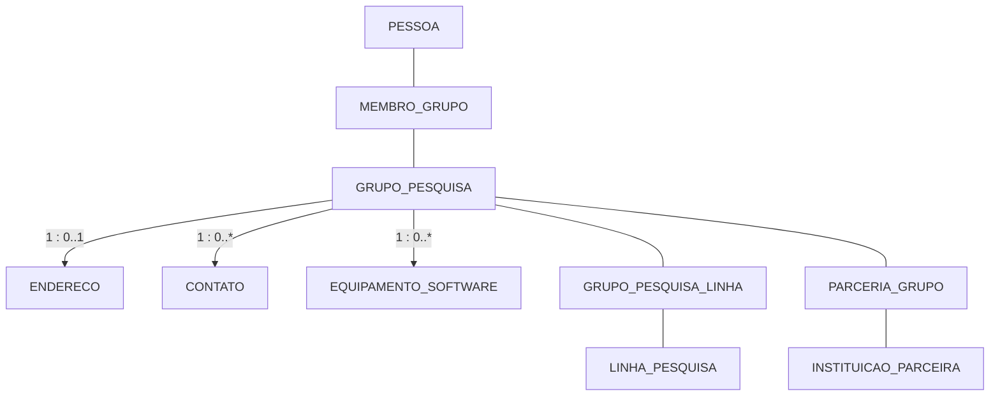

# Dicionário de Dados: Modelo Astah CNPq DGP

**Artefato**: `docs/astah_cnpq_dgp/cnpq_dgp_v3.asta`
**Padrão**: Senior ETL & Data Documentation Standards
**Última Atualização**: 2026-10-23
**Status**: Auditado e refinado minuciosamente com base no código do extrator (`dgp_cnpq_lib` / `CnpqCrawlerAdapter`), inspeção do arquivo `.asta` via Astah API e análise profunda de 542 registros reais do banco (`data/exports/source_records_canonical.json`).

---

## 1. Visão Geral do Modelo CNPq DGP v3

O modelo `cnpq_dgp_v3.asta` representa o espelho público oficial do Diretório dos Grupos de Pesquisa no Brasil (CNPq DGP). Ele está estruturado em **10 classes conceituais** (com normalização em 3FN de relacionamentos $N:N$ através de classes associativas e desacoplamento de endereço físico e canais de contato), **9 enumerações nativas** e **7 associações relacionais**.

---

## 2. Dicionário Detalhado por Classe e Mapeamento de Extração

---

### 2.1 `GRUPO_PESQUISA` (Entidade Central do DGP)

Representa a unidade básica e formal de organização do trabalho científico no Brasil, chancelada pela instituição mantenedora e certificada pelo CNPq.

| Atributo                     | Tipo Astah         | O que representa (Conceito de Negócio)                                                                                                                                                                                                                                                             | Origem no Payload & Regra ETL                                                                                                                  | Obrig. no DGP? | Exemplo Real Concreto                                                                  |
| ---------------------------- | ------------------ | --------------------------------------------------------------------------------------------------------------------------------------------------------------------------------------------------------------------------------------------------------------------------------------------------- | ---------------------------------------------------------------------------------------------------------------------------------------------- | :------------: | -------------------------------------------------------------------------------------- |
| `nome_grupo`               | `String`         | Denominação oficial do grupo de pesquisa institucional (ex: laboratório, núcleo de estudos ou coletivo científico).                                                                                                                                                                            | `nome_grupo`Texto limpo. Quando vier `"CNPq"` por artefato de cabeçalho do portal, o ETL faz fallback para a legenda original do espelho. | **Sim** | `"Linguagens, Culturas e Ensino"`                                                    |
| `situacao_do_grupo`        | `SituacaoGrupo`  | Estado administrativo do grupo perante o CNPq e a Pró-Reitoria: grupo ativo e regular (`CERTIFICADO`), com dados defasados sem atualização há mais de 12 meses (`CERTIFICADO_NAO_ATUALIZADO`), em formação (`EM_PREENCHIMENTO`) ou submetido à reitoria (`AGUARDANDO_CERTIFICACAO`). | `identificacao.situacao_do_grupo`Mapeado para a enumeração oficial `SituacaoGrupo`.                                                      | **Sim** | `CERTIFICADO`                                                                        |
| `ano_de_formacao`          | `Integer`        | Ano civil de fundação e início formal das atividades do grupo na instituição mantenedora.                                                                                                                                                                                                      | `identificacao.ano_de_formacao`Parse de string para número inteiro de 4 dígitos.                                                           | **Sim** | `2022`                                                                               |
| `data_da_situacao`         | `DateTime`       | Carimbo oficial de data e hora em que a situação cadastral vigente foi homologada pela autoridade institucional ou CNPq.                                                                                                                                                                          | `identificacao.data_da_situacao`Parse do padrão `"DD/MM/YYYY HH:MM"` para timestamp.                                                      | **Sim** | `2022-06-26 18:42:00`                                                                |
| `data_do_ultimo_envio`     | `DateTime`       | Data e hora em que o líder submeteu pela última vez o espelho do grupo atualizado ao CNPq (indicador-chave de vivacidade do grupo).                                                                                                                                                               | `identificacao.data_do_ultimo_envio`Parse do padrão `"DD/MM/YYYY HH:MM"` para timestamp.                                                  | **Sim** | `2026-05-25 08:35:00`                                                                |
| `grande_area_predominante` | `GrandeAreaCNPq` | Macro-área do conhecimento da taxonomia oficial do CNPq (ex: Engenharias, Ciências Humanas) que concentra a maior fatia dos projetos e membros.                                                                                                                                                   | `identificacao.area_predominante`Extrai o texto antes do caractere ponto-e-vírgula (`";"`), normalizado para enum `GrandeAreaCNPq`.     | **Sim** | `LINGUISTICA_LETRAS_E_ARTES`                                                         |
| `area_predominante`        | `String`         | Área acadêmica específica ou especialidade disciplinar do grupo.                                                                                                                                                                                                                                 | `identificacao.area_predominante`Extrai o texto após o ponto-e-vírgula (`";"`), ou a cadeia textual completa.                            | **Sim** | `"Letras"`                                                                           |
| `instituicao_do_grupo`     | `String`         | Razão social ou nome institucional por extenso da entidade mantenedora principal responsável pelo grupo.                                                                                                                                                                                          | `identificacao.instituicao_do_grupo`Texto padronizado em caixa mista.                                                                        | **Sim** | `"Instituto Federal de Educação, Ciência e Tecnologia do Espírito Santo - IFES"` |
| `unidade_campus`           | `String`         | Campus descentralizado, centro tecnológico ou unidade física de ensino onde o grupo opera fisicamente.                                                                                                                                                                                            | `identificacao.unidade`Texto limpo da unidade/campus.                                                                                        | **Sim** | `"Instituto Federal do Espírito Santo - Campus Serra"`                              |
| `repercussoes`             | `String`         | Texto livre redigido pelo líder sintetizando a relevância científica, impacto tecnológico, prêmios, eventos e inserção social do grupo.                                                                                                                                                      | `repercussoes.descricao` ou texto de fallback do fieldset.Texto descritivo longo; vazio quando não preenchido.                              |      Não      | `"O grupo desenvolve pesquisas sobre práticas de linguagem..."`                     |
| `link_espelho_dgp`         | `String`         | URL pública permanente de visualização do espelho no portal do CNPq. O sufixo numérico de 16 dígitos constitui a chave primária natural do grupo.                                                                                                                                             | URL canônica fornecida ao crawler (`http://dgp.cnpq.br/dgp/espelhogrupo/<ID>`).                                                             | **Sim** | `"http://dgp.cnpq.br/dgp/espelhogrupo/4099181037333209"`                             |

---

### 2.2 `ENDERECO` (Sede e Localização Física)

Desacoplado de `CONTATO` para conformidade estrita com a 3ª Forma Normal (3FN), separando geografia predial de canais telemáticos.

| Atributo         | Tipo Astah | O que representa (Conceito de Negócio)                                                            | Origem no Payload & Regra ETL                                                                   | Obrig. no DGP? | Exemplo Real Concreto                         |
| ---------------- | ---------- | -------------------------------------------------------------------------------------------------- | ----------------------------------------------------------------------------------------------- | :------------: | --------------------------------------------- |
| `logradouro`   | `String` | Nome da via pública oficial (avenida, rua, rodovia) onde o campus está sediado.                  | `endereco_contato.logradouro`Texto limpo.                                                     | **Sim** | `"Avenida Sabiás"`, `"Rodovia ES-010"`   |
| `numero`       | `String` | Numeração predial da entrada do campus institucional.                                            | `endereco_contato.numero`Pode ser número (`"330"`), `"s/n"` ou vazio (`""`).           |      Não      | `"330"`, `""`                             |
| `complemento`  | `String` | Detalhamento interno da localização no campus (bloco, sala, laboratório ou departamento).       | `endereco_contato.complemento`Texto livre ou string vazia quando omitido.                     |      Não      | `"Bloco 2, Laboratório 10"`, `""`        |
| `bairro`       | `String` | Bairro ou distrito municipal onde a sede física se situa.                                         | `endereco_contato.bairro`Texto padronizado.                                                   | **Sim** | `"Morada de Laranjeiras"`, `"Manguinhos"` |
| `localidade`   | `String` | Nome oficial do município / cidade sede do campus.                                                | `endereco_contato.localidade`Texto limpo.                                                     | **Sim** | `"Serra"`                                   |
| `uf`           | `UF`     | Unidade Federativa (estado brasileiro) da sede física do grupo.                                   | `endereco_contato.uf`Mapeado para enum `UF`.                                                | **Sim** | `ES`                                        |
| `cep`          | `String` | Código de Endereçamento Postal oficial dos Correios composto por 8 caracteres numéricos.        | `endereco_contato.cep`Apenas dígitos numéricos.                                             | **Sim** | `"29166630"`                                |
| `caixa_postal` | `String` | Caixa postal contratada nos Correios para recebimento de correspondências.                        | `endereco_contato.caixa_postal`Texto ou vazio quando inexistente.                             |      Não      | `"29166-630"`, `""`                       |
| `latitude`     | `String` | Coordenada geográfica de latitude da sede institucional (para mapas e visualizações espaciais). | `endereco_contato.latitude`String numérica ou `"0.0"` quando não geocodificado no portal. |      Não      | `"-20.1982"`, `"0.0"`                     |
| `longitude`    | `String` | Coordenada geográfica de longitude da sede institucional.                                         | `endereco_contato.longitude`String numérica ou `"0.0"` quando omitido.                     |      Não      | `"-40.2341"`, `"0.0"`                     |

**Associação**:

- `localizacao_contato`: `GRUPO_PESQUISA [1] ──── [0..1] ENDERECO`

---

### 2.3 `CONTATO` (Canais de Atendimento e Divulgação)

Meios de comunicação institucionais para colaborações, dúvidas e intercâmbio científico com a sociedade e empresas.

| Atributo             | Tipo Astah | O que representa (Conceito de Negócio)                                                                 | Origem no Payload & Regra ETL                                                                                                                     | Obrig. no DGP? | Exemplo Real Concreto           |
| -------------------- | ---------- | ------------------------------------------------------------------------------------------------------- | ------------------------------------------------------------------------------------------------------------------------------------------------- | :------------: | ------------------------------- |
| `telefone`         | `String` | Telefone fixo institucional ou ramal direto da secretaria/laboratório do grupo.                        | `endereco_contato.telefone`Pode ser `None`. No crawler/export, aplica máscara de proteção LGPD caso seja número pessoal.                  |      Não      | `"(27) 3348-9200"`, `null`  |
| `fax`              | `String` | Número de fax da unidade (campo legado histórico mantido pelo sistema do CNPq).                       | `endereco_contato.fax`Praticamente 100% dos grupos modernos possuem valor `null`.                                                             |      Não      | `null`                        |
| `contato_do_grupo` | `String` | E-mail eletrônico institucional do grupo ou do líder para recebimento de correspondência acadêmica. | `endereco_contato.contato_do_grupo`No pipeline, recebe hash/máscara LGPD (ex: `<hash>@anon.lgpd`) para evitar exposição de e-mail privado. |      Não      | `"1c631986ea1b@anon.lgpd"`    |
| `website`          | `String` | Endereço web (URL) da página institucional do laboratório, blog do grupo ou portal do campus.        | `endereco_contato.website`String de URL ou vazia (`""`).                                                                                      |      Não      | `"serra.ifes.edu.br"`, `""` |

---

### 2.4 `PESSOA` e `MEMBRO_GRUPO` (Recursos Humanos do Grupo)

Corpo acadêmico composto por pesquisadores docentes, estudantes orientados, técnicos administrativos e colaboradores externos.

| Classe / Atributo                           | Tipo Astah             | O que representa (Conceito de Negócio)                                                                                                                                                                                                   | Origem no Payload & Regra ETL                                                                                                                                                                                                                          | Obrig. no DGP? | Exemplo Real Concreto                                                     |
| ------------------------------------------- | ---------------------- | ----------------------------------------------------------------------------------------------------------------------------------------------------------------------------------------------------------------------------------------- | ------------------------------------------------------------------------------------------------------------------------------------------------------------------------------------------------------------------------------------------------------ | :------------: | ------------------------------------------------------------------------- |
| `PESSOA.nome`                             | `String`             | Nome civil completo do membro, exatamente como registrado em seu cadastro individual no CNPq.                                                                                                                                             | `recursos_humanos.*[].pesquisadores` ou `nome`O ETL higieniza artefatos HTML e ignora nomes de controle de interface (ex: `"ui-button"`).                                                                                                        | **Sim** | `"Adrianna Machado Meneguelli"`, `"Frances Alexandre Serpa Ferreira"` |
| `MEMBRO_GRUPO.papel`                      | `PapelMembro`        | Função e atribuição exercida no grupo: líder principal (`LIDER`), segundo líder (`VICE_LIDER`), docente (`PESQUISADOR`), aluno (`ESTUDANTE`), técnico de apoio (`TECNICO`) ou estrangeiro (`COLABORADOR_ESTRANGEIRO`). | Inserido pelo ETL conforme a seção ou fieldset de origem (`lideres_do_grupo`, `pesquisadores`, `estudantes`...).                                                                                                                               | **Sim** | `LIDER`, `PESQUISADOR`, `ESTUDANTE`                                 |
| `MEMBRO_GRUPO.status`                     | `StatusParticipacao` | Condição de atividade do membro: participando ativamente dos projetos (`ATIVO`) ou ex-integrante desligado (`EGRESSO`).                                                                                                             | `ATIVO` se vier das tabelas normais de RH; `EGRESSO` se vier das tabelas `egressos_*`.                                                                                                                                                           | **Sim** | `ATIVO`, `EGRESSO`                                                    |
| `MEMBRO_GRUPO.data_inicio`                | `Date`               | Data oficial em que o membro foi admitido pelo líder na equipe de pesquisa.                                                                                                                                                              | `*.data_inicio` ou `data_inclusao`.⚠️ **Atenção**: Para membros anteriores à reformulação do portal em 2014, o CNPq grava textualmente `"Anterior a abril de 2014"`. O ETL trata como data nula ou data sentinela (`2014-04-01`). | **Sim** | `2022-06-20`, `"Anterior a abril de 2014"`                            |
| `MEMBRO_GRUPO.data_fim`                   | `Date`               | Data de saída ou encerramento formal da participação do membro na equipe (vazio/nulo para membros ativos).                                                                                                                             | `*.data_fim` ou `data_egresso`Preenchido apenas nas tabelas de egressos; nulo (`null`) para membros ativos.                                                                                                                                      |      Não      | `2024-10-22` ou `null`                                                |
| `MEMBRO_GRUPO.titulacao_maxima`           | `TitulacaoMaxima`    | Maior grau acadêmico concluído pelo pesquisador (Doutorado, Mestrado, Especialização, Graduação...).                                                                                                                                | `recursos_humanos.pesquisadores[].titulacao_maxima`Presente em tabelas de pesquisadores ativos; nulo para estudantes e técnicos.                                                                                                                    |      Não      | `DOUTORADO`, `MESTRADO`                                               |
| `MEMBRO_GRUPO.nivel_treinamento`          | `NivelTreinamento`   | Nível do curso no qual o estudante atua no grupo (Graduação para IC, Mestrado, Ensino Médio para PIBIC-Jr...).                                                                                                                        | `recursos_humanos.estudantes[].nivel_de_treinamento`Presente em estudantes ativos; nulo para pesquisadores e técnicos.                                                                                                                              |      Não      | `GRADUACAO`, `MESTRADO`                                               |
| `MEMBRO_GRUPO.formacao_academica_tecnico` | `String`             | Habilitação profissional ou curso técnico do servidor que presta apoio aos ensaios e laboratórios.                                                                                                                                    | `recursos_humanos.tecnicos[].formacao_academica`Presente apenas na tabela de técnicos.                                                                                                                                                              |      Não      | `"Técnico em Eletrotécnica"`, `""`                                  |

**Associação**:

- `MEMBRO_GRUPO`: Classe associativa $N:N$ legítima conectando `PESSOA [1..*]` e `GRUPO_PESQUISA [1..*]`.

---

### 2.5 `LINHA_PESQUISA` e `GRUPO_PESQUISA_LINHA`

Eixos temáticos contínuos de investigação nos quais o grupo subdivide seus projetos, dissertações e publicações.

| Classe / Atributo             | Tipo Astah | O que representa (Conceito de Negócio)                                                                                                         | Origem no Payload & Regra ETL                                                        | Obrig. no DGP? | Exemplo Real Concreto                            |
| ----------------------------- | ---------- | ----------------------------------------------------------------------------------------------------------------------------------------------- | ------------------------------------------------------------------------------------ | :------------: | ------------------------------------------------ |
| `LINHA_PESQUISA.nome_linha` | `String` | Nome oficial do eixo temático de investigação científica cadastrado no CNPq (ex: inteligência artificial aplicada, estudos comparatistas). | `linhas_de_pesquisa.linhas[].nome_da_linha_de_pesquisa`Texto limpo e desduplicado. | **Sim** | `"Comunicação"`, `"Estudos comparatistas"` |

**Associação**:

- `GRUPO_PESQUISA_LINHA`: Classe associativa $N:N$ legítima conectando `GRUPO_PESQUISA [1..*]` e `LINHA_PESQUISA [1..*]`.
- ⚠️ **Divergência detectada no Astah**: A associação simples duplicada `Pesquisa em` que ainda conecta as duas classes deve ser **deletada**.

---

### 2.6 `INSTITUICAO_PARCEIRA` e `PARCERIA_GRUPO`

Entidades públicas, privadas ou redes cooperativas conveniadas com o grupo de pesquisa para apoio financeiro, cessão de laboratórios ou projetos conjuntos.

| Classe / Atributo                         | Tipo Astah       | O que representa (Conceito de Negócio)                                                                                                                                  | Origem no Payload & Regra ETL                                                                   | Obrig. no DGP? | Exemplo Real Concreto                                                                                                |
| ----------------------------------------- | ---------------- | ------------------------------------------------------------------------------------------------------------------------------------------------------------------------ | ----------------------------------------------------------------------------------------------- | :------------: | -------------------------------------------------------------------------------------------------------------------- |
| `INSTITUICAO_PARCEIRA.nome_instituicao` | `String`       | Nome oficial ou razão social da empresa conveniada, universidade cooperadora ou rede INCT parceira.                                                                     | `instituicoes_parceiras_relatadas_pelo_grupo.items[][].nome_da_instituicao_parceira`          | **Sim** | `"Universidade Federal do Espírito Santo"`, `"ArcelorMittal Brasil - Matriz"`, `"Companhia Vale do Rio Doce"` |
| `INSTITUICAO_PARCEIRA.sigla`            | `String`       | Sigla corporativa ou acrônimo oficial da instituição parceira.                                                                                                        | `instituicoes_parceiras_*.sigla`Texto limpo da sigla.                                         |      Não      | `"UFES"`, `"ARCELORMITTAL"`, `"CVRD"`                                                                          |
| `INSTITUICAO_PARCEIRA.uf`               | `UF`           | Unidade federativa da sede da instituição parceira. É nula (`null`) para instituições sediadas no exterior.                                                       | `instituicoes_parceiras_*.uf`Mapeado para enum `UF` ou `null` quando internacional.       |      Não      | `ES`, `MG`, `RJ`, ou `null` (ex: Universidad de Alcalá)                                                     |
| `PARCERIA_GRUPO.tipo_parceria`          | `TipoParceria` | Natureza jurídica e administrativa do convênio: cooperação convencional (`INSTITUICAO_PARCEIRA`) ou rede nacional de excelência do CNPq/MCTI (`INCT_PARCEIRO`). | Mapeado conforme o bloco de origem no espelho (fieldset 7 de parceiros vs fieldset 8 de INCTs). | **Sim** | `INSTITUICAO_PARCEIRA`, `INCT_PARCEIRO`                                                                          |
| `PARCERIA_GRUPO.attribute8`             | `int`          | ⚠️ **ATRIBUTO RESIDUAL A REMOVER**: Inserido acidentalmente por clique no Astah. Não tem significado conceitual e causa erro na auditoria estrita.              | Nenhuma origem no extrator.                                                                     |       —       | —                                                                                                                   |

**Associação**:

- `PARCERIA_GRUPO`: Classe associativa $N:N$ legítima conectando `GRUPO_PESQUISA [1..*]` e `INSTITUICAO_PARCEIRA [1..*]`.

---

### 2.7 `EQUIPAMENTO_SOFTWARE` (Infraestrutura Declarada)

Instrumental laboratorial científico de grande porte ou pacotes de software especializados declarados pelo grupo.

| Atributo | Tipo Astah             | O que representa (Conceito de Negócio)                                                                                   | Origem no Payload & Regra ETL                                                           | Obrig. no DGP? | Exemplo Real Concreto                                                       |
| -------- | ---------------------- | ------------------------------------------------------------------------------------------------------------------------- | --------------------------------------------------------------------------------------- | :------------: | --------------------------------------------------------------------------- |
| `nome` | `String`             | Nome técnico, marca ou modelo do equipamento físico ou software científico declarado pelo grupo.                       | `equipamentos_e_softwares_relevantes.items[][].equipamentos` ou `softwares`.        | **Sim** | `"Espectrometro Raman"`, `"Servidor Dell PowerEdge R740"`, `"ArcGIS"` |
| `tipo` | `TipoInfraestrutura` | Classifica o ativo em bem de infraestrutura física de bancada (`EQUIPAMENTO`) ou recurso computacional (`SOFTWARE`). | Mapeado para o enum `TipoInfraestrutura` com base na subseção da tabela afirmativa. | **Sim** | `EQUIPAMENTO`, `SOFTWARE`                                               |

> [!NOTE]
> **Comportamento no Crawler**: Quando o grupo declara `"Não"` nas perguntas de infraestrutura superior a R$ 100 mil, o extrator retorna apenas o texto descritivo geral em `{'descricao': '...'}`. Nenhuma linha é inserida em `EQUIPAMENTO_SOFTWARE` nesse caso, preservando a fidelidade relacional.

**Associação**:

- `infraestrutura_declarada`: `GRUPO_PESQUISA [1] ──── [0..*] EQUIPAMENTO_SOFTWARE`

---

## 3. Tabelas de Consulta (`<<enumeration>>` — 9 Domínios Oficiais DGP)

| Enumeração                     | Finalidade no Domínio DGP                                                                                            | Valores Permitidos                                                                                                                                                                                                                 | Dependência UML «use»               |
| -------------------------------- | --------------------------------------------------------------------------------------------------------------------- | ---------------------------------------------------------------------------------------------------------------------------------------------------------------------------------------------------------------------------------- | -------------------------------------- |
| **`SituacaoGrupo`**      | Validade e regularidade administrativa do certificado do grupo no CNPq.                                               | `CERTIFICADO`, `CERTIFICADO_NAO_ATUALIZADO`, `EM_PREENCHIMENTO`, `AGUARDANDO_CERTIFICACAO`                                                                                                                                 | `GRUPO_PESQUISA`                     |
| **`PapelMembro`**        | Função hierárquica e acadêmica desempenhada pelo indivíduo na equipe.                                            | `LIDER`, `VICE_LIDER`, `PESQUISADOR`, `ESTUDANTE`, `TECNICO`, `COLABORADOR_ESTRANGEIRO`                                                                                                                                | `MEMBRO_GRUPO`                       |
| **`StatusParticipacao`** | Condição de atividade do membro (em exercício ativo ou desligado/egresso).                                         | `ATIVO`, `EGRESSO`                                                                                                                                                                                                             | `MEMBRO_GRUPO`                       |
| **`TitulacaoMaxima`**    | Maior nível de formação acadêmica concluído declarado pelo pesquisador.                                          | `DOUTORADO`, `MESTRADO`, `MESTRADO_PROFISSIONAL`, `ESPECIALIZACAO`, `GRADUACAO`, `ENSINO_MEDIO_TECNICO`, `OUTRA`                                                                                                     | `MEMBRO_GRUPO`                       |
| **`NivelTreinamento`**   | Grau de ensino ou nível acadêmico de matrícula dos estudantes.                                                     | `POS_DOUTORADO`, `DOUTORADO`, `MESTRADO`, `MESTRADO_PROFISSIONAL`, `MBA`, `ESPECIALIZACAO`, `GRADUACAO`, `ENSINO_PROFISSIONAL_TECNICO`, `ENSINO_MEDIO_2O_GRAU`                                                   | `MEMBRO_GRUPO`                       |
| **`GrandeAreaCNPq`**     | 9 macro-áreas oficiais da árvore do conhecimento do CNPq.                                                           | `CIENCIAS_EXATAS_E_DA_TERRA`, `CIENCIAS_BIOLOGICAS`, `ENGENHARIAS`, `CIENCIAS_DA_SAUDE`, `CIENCIAS_AGRARIAS`, `CIENCIAS_SOCIAIS_APLICADAS`, `CIENCIAS_HUMANAS`, `LINGUISTICA_LETRAS_E_ARTES`, `MULTIDISCIPLINAR` | `GRUPO_PESQUISA`                     |
| **`TipoInfraestrutura`** | Natureza do ativo de infraestrutura científica declarada.                                                            | `EQUIPAMENTO`, `SOFTWARE`                                                                                                                                                                                                      | `EQUIPAMENTO_SOFTWARE`               |
| **`TipoParceria`**       | Modalidade de convênio institucional com terceiros.                                                                  | `INSTITUICAO_PARCEIRA`, `INCT_PARCEIRO`                                                                                                                                                                                        | `PARCERIA_GRUPO`                     |
| **`UF`**                 | 27 Unidades Federativas do Brasil (para endereços e parceiros nacionais). Parceiros estrangeiros recebem valor nulo. | `AC`, `AL`, `AM`, `AP`, `BA`, `CE`, `DF`, `ES`, `GO`, `MA`, `MG`, `MS`, `MT`, `PA`, `PB`, `PE`, `PI`, `PR`, `RJ`, `RN`, `RO`, `RR`, `RS`, `SC`, `SE`, `SP`, `TO`             | `ENDERECO`, `INSTITUICAO_PARCEIRA` |
