# Dicionário de Dados: Modelo Astah Lattes

**Artefato**: `docs/astah_lattes/lattes_v3.asta`
**Padrão**: Senior ETL & Data Documentation Standards
**Última Atualização**: 2026-10-22
**Status**: Auditado e refinado com descrições conceituais de negócio e mapeamento do extrator (`data/lattes_json/*.json` e `src/adapters/sources/lattes_parser.py`)

---

## 1. Visão Geral do Modelo Lattes v3

O modelo `lattes_v3.asta` organiza os dados curriculares do CNPq Lattes em **21 classes** (incluindo a nova classe `INSTITUICAO`), **16 enumerações de domínio** e **26 associações relacionais**.

```mermaid
flowchart TD
    P[PESSOA] --> FA[FORMACAO_ACADEMICA]
    P --> AP[ATUACAO_PROFISSIONAL]
    P --> MP[MEMBRO_PROJETO] --> PRJ[PROJETO]
    P --> ORI[ORIENTACAO]
    P --> BE[BANCA_EXAMINADORA]
    P --> PE[PARTICIPACAO_EVENTO] --> EC[EVENTO_CIENTIFICO]
    P --> PI[PROFICIENCIA_IDIOMA] --> IDI[IDIOMA]
    P --> PT[PREMIO_TITULO]
    P --> AA[AREA_ATUACAO]
    P --> LP[LINHA_PESQUISA]
  
    %% Produções
    P --> ATE[ARTIGO_TRABALHO_EVENTO]
    P --> LC[LIVRO_CAPITULO]
    P --> PTAB[PRODUCAO_TECNICA_ARTISTICA_BIBLIOGRAFICA]
    P --> PAT[PATENTE_REGISTRO]
  
    %% Instituição Central
    INS[INSTITUICAO] -.->|promove| FA
    INS -.->|ocorre em| AP
    INS -.->|ocorre em| ORI
    INS -.->|possui| PAT
  
    %% Financiamento
    IF[INSTITUICAO_FINANCIADORA] --> FP[FOMENTO_PROJETO] --> PRJ
    IF -.->|financia| ORI
```

---

## 2. Dicionário Detalhado por Classe e Mapeamento de Extração

---

### 2.1 `PESSOA` (Entidade Raiz do Currículo)

Representa o pesquisador titular do currículo Lattes e/ou terceiros citados (coautores, orientados, membros de banca).

| Atributo                  | Tipo Astah | O que representa (Conceito de Negócio)                                                                                           | Origem no Extract JSON & Regra ETL                                                                   | Exemplo Real                                          |
| ------------------------- | ---------- | --------------------------------------------------------------------------------------------------------------------------------- | ---------------------------------------------------------------------------------------------------- | ----------------------------------------------------- |
| `id_lattes`             | `String` | Identificador público permanente do CNPq composto por 16 dígitos decimais (chave primária natural do pesquisador).             | `informacoes_pessoais.id_lattes`Texto limpo. *(Pode ser nulo para coautores/orientados sem CV)*. | `"7853087416950443"`                                |
| `nome_completo`         | `String` | Nome civil completo e oficial do titular ou colaborador cadastrado na base da Receita Federal e CNPq.                             | `informacoes_pessoais.nome_completo`Texto em caixa mista normalizado.                              | `"Cristina Klippel Dominicini"`                     |
| `nome_citacoes`         | `String` | Variações do nome do autor usadas em indexadores bibliográficos (ex: Scopus, Web of Science, Google Scholar).                  | `informacoes_pessoais.nome_citacoes`Lista textual delimitada por ponto-e-vírgula.                 | `"DOMINICINI, C. K.; Dominicini, Cristina Klippel"` |
| `sexo`                  | `Sexo`   | Gênero autodeclarado pelo titular no cadastro individual do Lattes.                                                              | `informacoes_pessoais.sexo`Mapeado para enum `MASCULINO` / `FEMININO`.                         | `FEMININO`                                          |
| `texto_resumo`          | `String` | Biografia autodeclarada pelo pesquisador sintetizando formação acadêmica, cargos, linhas de pesquisa e destaques científicos. | `informacoes_pessoais.texto_resumo`Texto bruto do resumo curricular.                               | `"Possui doutorado em Ciência da Computação..."` |
| `bolsa_produtividade`   | `String` | Categoria e nível da bolsa de produtividade em pesquisa ou desenvolvimento tecnológico do CNPq/FAPES (se houver).               | `informacoes_pessoais.bolsa_produtividade`Texto livre ou string vazia.                             | `"PQ Nível C"` ou `""`                           |
| `endereco_profissional` | `String` | Endereço postal e institucional do local de trabalho principal declarado pelo pesquisador.                                       | `informacoes_pessoais.endereco_profissional`Texto descritivo do campus/laboratório.               | `"Rodovia ES-010, Manguinhos, Serra, ES"`           |
| `url_curriculo`         | `String` | Endereço web canônico e permanente para acesso público ao currículo no portal do CNPq.                                        | `informacoes_pessoais.url`URL oficial do CNPq com id de 16 dígitos.                               | `"http://lattes.cnpq.br/7853087416950443"`          |
| `data_atualizacao_cv`   | `Date`   | Data em que o pesquisador realizou a última submissão de alterações no seu currículo à base do CNPq.                        | `informacoes_pessoais.atualizacao_cv`Parse de `"DD/MM/YYYY"`.                                    | `2026-09-29`                                        |

---

### 2.2 `INSTITUICAO` (Entidade Organizacional Central)

Unifica as organizações de ensino, pesquisa, fomento e empresas onde o pesquisador atua, se forma ou deposita ativos.

| Atributo              | Tipo Astah                                 | O que representa (Conceito de Negócio)                                                                              | Origem no Extract JSON & Regra ETL                                                                                | Exemplo Real                               |
| --------------------- | ------------------------------------------ | -------------------------------------------------------------------------------------------------------------------- | ----------------------------------------------------------------------------------------------------------------- | ------------------------------------------ |
| `nome_instituicao`  | `String`                                 | Razão social ou nome institucional por extenso da universidade, instituto de pesquisa, empresa ou órgão público. | `atuacao_profissional[].instituicao_nome` ou `formacao_academica[].nome_instituicao`Nome institucional limpo. | `"Instituto Federal do Espírito Santo"` |
| `sigla_instituicao` | `String` *(corrigir `int` no Astah)* | Sigla oficial ou acrônimo pelo qual a organização é reconhecida no meio acadêmico e corporativo.                | `atuacao_profissional[].instituicao_sigla`Texto limpo da sigla institucional.                                   | `"IFES"`, `"UFES"`, `"USP"`          |
| `instituicao_pais`  | `String`                                 | País de origem ou sede da organização (padrão Brasil ou país estrangeiro em vínculos internacionais).          | `atuacao_profissional[].instituicao_pais`String textual (padrão `"Brasil"`).                                 | `"Brasil"`, `"Estados Unidos"`         |

**Associações na v3**:

- `promove`: `FORMACAO_ACADEMICA [0..*] ──── [1] INSTITUICAO`
- `ocorre em`: `ATUACAO_PROFISSIONAL [1..*] ──── [1..*] INSTITUICAO`
- `ocorre em`: `ORIENTACAO [0..*] ──── [1] INSTITUICAO`
- `possui`: `PATENTE_REGISTRO [0..*] ──── [1] INSTITUICAO`

---

### 2.3 `FORMACAO_ACADEMICA`

Histórico de graduações, pós-graduações e cursos de titulação do pesquisador.

| Atributo              | Tipo Astah       | O que representa (Conceito de Negócio)                                                                                       | Origem no Extract JSON & Regra ETL                                                         | Exemplo Real                                       |
| --------------------- | ---------------- | ----------------------------------------------------------------------------------------------------------------------------- | ------------------------------------------------------------------------------------------ | -------------------------------------------------- |
| `tipo_formacao`     | `TipoFormacao` | Nível acadêmico do curso realizado: graduação, aperfeiçoamento, especialização, mestrado, doutorado ou pós-doutorado. | `formacao_academica[].tipo`Normalizado para enum oficial de formação.                  | `DOUTORADO`                                      |
| `curso`             | `String`       | Nome do curso, programa de pós-graduação ou área de concentração em que o pesquisador obteve a titulação.             | `formacao_academica[].tipo` (extraído)Texto do curso/área.                             | `"Informática"`, `"Engenharia Elétrica"`     |
| `nome_instituicao`  | `String`       | Nome da universidade promotora *(redundante no Astah com a associação direta para `INSTITUICAO`)*.                      | `formacao_academica[].nome_instituicao`Texto da instituição.                           | `"Universidade Federal do Espírito Santo"`      |
| `ano_inicio`        | `Integer`      | Ano civil de ingresso formal e início dos estudos no curso.                                                                  | `formacao_academica[].ano_inicio`Inteiro de 4 dígitos.                                  | `2015`                                           |
| `ano_conclusao`     | `Integer`      | Ano civil de conclusão e homologação do diploma ou ata de defesa (nulo se o curso estiver em andamento).                   | `formacao_academica[].ano_conclusao`Inteiro ou `null` se em andamento.                 | `2019`                                           |
| `titulo_trabalho`   | `String`       | Título oficial da tese de doutorado, dissertação de mestrado, monografia de especialização ou TCC de graduação.        | `formacao_academica[].descricao`Extraído via regex do bloco de título.                 | `"PolKA: Roteamento na Fonte Baseado..."`        |
| `descricao`         | `String`       | Texto bruto do currículo detalhando orientadores, agências financiadoras de bolsa e palavras-chave do trabalho.             | `formacao_academica[].descricao`Texto completo da formação.                            | `"Título: ... Orientador: ... Bolsista: CAPES"` |
| `nome_orientador`   | `String`       | Nome civil do docente responsável pela orientação acadêmica do titular no curso.                                          | `formacao_academica[].descricao`Extraído via regex do padrão `"Orientador: (.*)"`.   | `"Moises Renato Nunes Ribeiro"`                  |
| `nome_coorientador` | `String`       | Nome do docente coorientador formalmente designado para apoiar a condução dos estudos.                                      | `formacao_academica[].descricao`Extraído via regex do padrão `"Coorientador: (.*)"`. | `"Magnos Martinello"`                            |

---

### 2.4 `ATUACAO_PROFISSIONAL`

Histórico de empregos, cargos públicos, docência e vínculos empregatícios do pesquisador.

| Atributo            | Tipo Astah  | O que representa (Conceito de Negócio)                                                                                     | Origem no Extract JSON & Regra ETL                                                           | Exemplo Real                                |
| ------------------- | ----------- | --------------------------------------------------------------------------------------------------------------------------- | -------------------------------------------------------------------------------------------- | ------------------------------------------- |
| `ano_inicio`      | `Integer` | Ano civil de posse, contratação ou início formal do exercício profissional na instituição.                            | `atuacao_profissional[].ano_inicio`Inteiro de 4 dígitos.                                  | `2013`                                    |
| `ano_fim`         | `Integer` | Ano civil de encerramento, demissão ou exoneração do vínculo (nulo quando o vínculo permanece em vigor).               | `atuacao_profissional[].ano_fim`Inteiro ou `null` se vínculo ativo.                     | `2024` ou `null`                        |
| `atual`           | `Boolean` | Indicador booleano que expressa se o pesquisador continua prestando serviços à instituição no momento atual.            | `atuacao_profissional[].periodotrue` se o período contiver `"Atual"`, senão `false`. | `true`                                    |
| `vinculo`         | `String`  | Regime jurídico do contrato de trabalho (ex: servidor público estatutário, celetista, bolsista, celetista, voluntário). | `atuacao_profissional[].vinculo`Texto da modalidade jurídica.                             | `"Servidor público"`, `"Celetista"`    |
| `enquadramento`   | `String`  | Carreira, cargo efetivo ou denominação funcional ocupada na estrutura organizacional da instituição.                    | `atuacao_profissional[].enquadramento`Texto da carreira funcional.                         | `"Professor Ensino Básico..."`           |
| `cargo_funcao`    | `String`  | Cargo de direção, chefia departamental ou função comissionada de confiança exercida temporariamente (ex: CD, FG).      | `atuacao_profissional[].cargo_funcao`Texto da função administrativa.                     | `"Coordenadora de Informática"`          |
| `regime_trabalho` | `String`  | Carga horária semanal contratada e regime de dedicação profissional acordado com a instituição.                        | `atuacao_profissional[].regime`Texto descritivo do regime de horas.                        | `"Dedicação exclusiva"`, `"40 horas"` |
| `atividades`      | `String`  | Relação detalhada de atribuições, projetos setoriais e encargos rotineiros desenvolvidos pelo profissional.             | `atuacao_profissional[].atividades`Texto descritivo das atribuições.                     | `"Ensino, pesquisa e extensão..."`       |
| `disciplinas`     | `String`  | Matérias e componentes curriculares ministrados pelo docente nos cursos da instituição de lotação.                     | `atuacao_profissional[].disciplinas`Lista de disciplinas do docente.                       | `"Redes de Computadores I"`               |

---

### 2.5 `PROJETO` e `MEMBRO_PROJETO`

Iniciativas de pesquisa científica, extensão comunitária e desenvolvimento tecnológico.

| Classe / Atributo         | Tipo Astah       | O que representa (Conceito de Negócio)                                                                                                             | Origem no Extract JSON & Regra ETL                                                | Exemplo Real                                            |
| ------------------------- | ---------------- | --------------------------------------------------------------------------------------------------------------------------------------------------- | --------------------------------------------------------------------------------- | ------------------------------------------------------- |
| `PROJETO.nome`          | `String`       | Título oficial e público da proposta do projeto aprovada pelo órgão colegiado ou agência de fomento.                                           | `projetos_*.nome`Texto do título limpo.                                        | `"Núcleo Emergente em Redes Definidas por Software"` |
| `PROJETO.tipo_projeto`  | `TipoProjeto`  | Natureza primária da iniciativa: investigação acadêmica (`PESQUISA`), ação comunitária (`EXTENSAO`) ou inovação (`DESENVOLVIMENTO`). | Chave de origem no JSON (`projetos_pesquisa`, `projetos_extensao`...).        | `PESQUISA`                                            |
| `PROJETO.ano_inicio`    | `Integer`      | Ano civil em que o projeto iniciou suas atividades formais de execução.                                                                           | `projetos_*.ano_inicio`Inteiro de 4 dígitos.                                   | `2017`                                                |
| `PROJETO.ano_conclusao` | `Integer`      | Ano civil de encerramento formal do projeto ou término previsto para execução.                                                                   | `projetos_*.ano_conclusao`Inteiro de 4 dígitos ou `null`.                    | `2020` ou `null`                                    |
| `PROJETO.situacao`      | `StatusCiclo`  | Estágio de execução do projeto na instituição: em andamento, concluído ou desativado.                                                         | `projetos_*.descricao`Parse de `"Situação: Em andamento / Concluído"`.     | `CONCLUIDO`                                           |
| `PROJETO.descricao`     | `String`       | Resumo dos objetivos, justificativa teórica, metodologia e metas esperadas com o desenvolvimento do projeto.                                       | `projetos_*.descricao`Texto do escopo do projeto.                               | `"O projeto visa desenvolver novos protocolos..."`    |
| `MEMBRO_PROJETO.papel`  | `PapelProjeto` | Nível de responsabilidade do integrante na equipe executora: coordenador-geral (`COORDENADOR`) ou membro técnico (`INTEGRANTE`).              | `projetos_*.integrantes[].papel`Parse de `"Coordenador"` vs `"Integrante"`. | `COORDENADOR`                                         |

---

### 2.6 `FOMENTO_PROJETO` e `INSTITUICAO_FINANCIADORA`

Recursos financeiros, custeio e cotas de bolsas aportados por agências de fomento governamentais ou empresas parceiras.

| Classe / Atributo                             | Tipo Astah                 | O que representa (Conceito de Negócio)                                                                                                                                | Origem no Extract JSON & Regra ETL                                           | Exemplo Real                                 |
| --------------------------------------------- | -------------------------- | ---------------------------------------------------------------------------------------------------------------------------------------------------------------------- | ---------------------------------------------------------------------------- | -------------------------------------------- |
| `INSTITUICAO_FINANCIADORA.nome_financiador` | `String`                 | Nome oficial da entidade de suporte público ou privado provedora do financiamento (ex: CNPq, CAPES, FAPES, Petrobras).                                                | `projetos_*.financiadores[].nome`Nome limpo da entidade fomentadora.       | `"Fundação de Amparo à Pesquisa do ES"` |
| `FOMENTO_PROJETO.tipo_apoio`                | `TipoApoioFinanciamento` | Classificação da modalidade do aporte: verba de custeio/capital (`AUXILIO_FINANCEIRO`), concessão de estipêndios (`BOLSA`) ou remuneração (`REMUNERACAO`). | `projetos_*.financiadores[].tipo_apoio`Mapeado para enum de financiamento. | `AUXILIO_FINANCEIRO`                       |

---

### 2.7 `ORIENTACAO`

Supervisão acadêmica e mentoria científica de alunos de graduação e pós-graduação pelo pesquisador.

| Atributo             | Tipo Astah               | O que representa (Conceito de Negócio)                                                                                  | Origem no Extract JSON & Regra ETL                                           | Exemplo Real                                             |
| -------------------- | ------------------------ | ------------------------------------------------------------------------------------------------------------------------ | ---------------------------------------------------------------------------- | -------------------------------------------------------- |
| `titulo`           | `String`               | Título da tese, dissertação, monografia ou plano de trabalho de iniciação científica desenvolvido pelo orientando. | `orientacoes.*[].titulo`Texto do título acadêmico.                       | `"Mecanismos para mitigação de vulnerabilidades..."` |
| `modalidade`       | `ModalidadeOrientacao` | Nível de ensino acadêmico no qual a orientação é conduzida: IC, TCC, Mestrado, Doutorado ou Pós-Doutorado.         | Chave do grupo no JSON (`mestrado`, `iniciacao_cientifica`...).          | `MESTRADO`                                             |
| `papel_orientacao` | `PapelOrientacao`      | Condição de atuação do pesquisador perante o estudante: orientador principal titular ou docente coorientador.        | Regex no texto bruto do Lattes (`"Orientador"` vs `"Coorientador"`).     | `ORIENTADOR`                                           |
| `status`           | `StatusCiclo`          | Situação atual do processo de orientação: em andamento (estudos vigentes) ou concluído (defesa realizada).          | Chave de topo no JSON (`concluidas` vs `em_andamento`).                  | `EM_ANDAMENTO`                                         |
| `ano_inicio`       | `Integer`              | Ano civil em que o aluno começou as atividades formais sob a tutela do docente.                                         | `orientacoes.em_andamento[].ano_inicio`Inteiro de 4 dígitos.              | `2026`                                                 |
| `ano_conclusao`    | `Integer`              | Ano de realização da defesa pública final e encerramento da orientação.                                             | `orientacoes.concluidas[].ano_conclusao`Inteiro de 4 dígitos ou `null`. | `2024` ou `null`                                     |
| `curso`            | `String`               | Nome do curso de graduação ou programa de pós-graduação onde o orientando está matriculado.                        | `orientacoes.*[].curso`Texto do curso/programa.                            | `"Mestrado em Computação Aplicada"`                  |
| `tipo_trabalho`    | `String`               | Documento acadêmico resultante da orientação (ex: Dissertação, Tese, Monografia ou Relatório Final).               | `orientacoes.*[].tipo_trabalho`Texto descritivo do tipo documental.        | `"Dissertação de mestrado"`                          |

**Associações**:

- `orienta`: `PESSOA [1] ──── [0..*] ORIENTACAO`
- `orientado em`: `PESSOA [0..1] ──── [0..*] ORIENTACAO`
- `ocorre em`: `ORIENTACAO [0..*] ──── [1] INSTITUICAO`
- `financia orientacao`: `INSTITUICAO_FINANCIADORA [0..1] ──── [0..*] ORIENTACAO`

---

### 2.8 `ARTIGO_TRABALHO_EVENTO` (Produção Científica)

Publicações bibliográficas em revistas acadêmicas indexadas e artigos veiculados em anais de simpósios e congressos.

| Atributo                   | Tipo Astah           | O que representa (Conceito de Negócio)                                                                                                         | Origem no Extract JSON & Regra ETL                                             | Exemplo Real                                             |
| -------------------------- | -------------------- | ----------------------------------------------------------------------------------------------------------------------------------------------- | ------------------------------------------------------------------------------ | -------------------------------------------------------- |
| `titulo`                 | `String`           | Título formal do artigo científico ou comunicação publicado em periódico ou anais.                                                         | `artigos_periodicos[].titulo` ou `trabalhos_completos_congressos[].titulo` | `"MTS-PolKA: Weighted Multipath Traffic Splitting..."` |
| `tipo_publicacao`        | `TipoArtigoEvento` | Tipologia bibliográfica: artigo avaliado por pares em revista (`ARTIGO_PERIODICO`) ou artigo em congresso (`TRABALHO_COMPLETO_CONGRESSO`). | Chave de origem no JSON, mapeada para enum.                                    | `ARTIGO_PERIODICO`                                     |
| `ano`                    | `Integer`          | Ano civil em que a edição da revista ou os anais do evento foram publicados.                                                                  | `artigos_periodicos[].ano`Inteiro de 4 dígitos.                             | `2025`                                                 |
| `veiculo_revista_evento` | `String`           | Nome do periódico especializado (revista científica) ou nome do congresso/simpósio onde o trabalho foi apresentado.                          | `artigos_periodicos[].revista` ou `trabalhos_congressos[].evento`          | `"International Journal of Network Management"`        |
| `doi`                    | `String`           | Identificador de Objeto Digital (*Digital Object Identifier*), link persistente universal para a publicação original na web.                | `artigos_periodicos[].doi`URI ou código DOI limpo.                          | `"http://dx.doi.org/10.1002/nem.70016"`                |
| `issn_isbn`              | `String`           | Código identificador internacional de publicações periódicas (ISSN) ou de livros/anais (ISBN).                                              | `artigos_periodicos[].issn`Código numérico com hífen.                     | `"1055-7148"`                                          |
| `volume`                 | `String`           | Tomo ou número do volume da revista científica em que o artigo foi indexado.                                                                  | `artigos_periodicos[].volume`Texto numérico ou romano.                      | `"35"`                                                 |
| `numero`                 | `String`           | Número do fascículo, edição periódica ou edição especial da revista.                                                                     | `artigos_periodicos[].numero`Texto da edição ou vazio.                     | `"2"` ou `""`                                        |
| `paginas`                | `String`           | Intervalo de páginas do artigo (ex: `"10-25"`) ou identificador de artigo eletrônico (artigo ID).                                           | `artigos_periodicos[].paginas`Faixa de páginas.                             | `"1-18"`                                               |
| `cidade`                 | `String`           | Cidade onde se realizou a conferência científica ou sede da revista publicadora.                                                              | `trabalhos_congressos[].cidade`Nome do município.                           | `"Brasília"`                                          |
| `data_publicacao`        | `String`           | Data de publicação formal disponibilizada no Lattes (quando informada dia e mês).                                                            | `artigos_periodicos[].data`Texto textual da data.                            | `"2025-01-15"`                                         |
| `natureza`               | `String`           | Extensão e profundidade do conteúdo submetido: trabalho completo, resumo expandido ou resumo simples.                                         | `artigos_periodicos[].natureza`Texto de classificação de conteúdo.        | `"Completo"`                                           |

---

### 2.9 `LIVRO_CAPITULO`

Livros integrais de autoria própria, coletâneas organizadas e capítulos de livros publicados com corpo editorial.

| Atributo         | Tipo Astah            | O que representa (Conceito de Negócio)                                                                                                | Origem no Extract JSON & Regra ETL                              | Exemplo Real                                          |
| ---------------- | --------------------- | -------------------------------------------------------------------------------------------------------------------------------------- | --------------------------------------------------------------- | ----------------------------------------------------- |
| `titulo`       | `String`            | Título principal da obra autoral ou título do capítulo avulso publicado.                                                            | `livros_publicados[].titulo` ou `capitulos_livros[].titulo` | `"Engenharia 4.0: a era da produção inteligente"` |
| `tipo`         | `TipoLivroCapitulo` | Natureza editorial: livro completo autoral/organizado (`LIVRO_PUBLICADO`) ou fração integrante de coletânea (`CAPITULO_LIVRO`). | Chave de origem no JSON, mapeada para enum.                     | `CAPITULO_LIVRO`                                    |
| `titulo_livro` | `String`            | Nome do livro completo que agrega a coletânea de capítulos de múltiplos autores.                                                    | `capitulos_livros[].titulo_livro`Texto do livro agregado.     | `"Coletânea de Redes"`                             |
| `ano`          | `Integer`           | Ano civil de impressão ou lançamento digital oficial da publicação.                                                                | `*.ano`Inteiro de 4 dígitos.                                 | `2024`                                              |
| `editora`      | `String`            | Razão social ou selo da casa publicadora ou editora universitária responsável pela produção do livro.                             | `*.editora`Nome da editora.                                   | `"Editora Pascal LTDA"`                             |
| `cidade`       | `String`            | Cidade sede da editora onde a obra foi catalogada e registrada.                                                                        | `*.cidade`Nome da cidade.                                     | `"São Paulo"`                                      |
| `isbn`         | `String`            | Padrão Internacional de Numeração de Livro (*International Standard Book Number*), identificador universal de 10 ou 13 dígitos.  | `*.isbn`Código oficial formatado com traços.                | `"978-65-87123-01-2"`                               |
| `edicao`       | `String`            | Número ordinal da tiragem/edição publicada (ex: 1ª edição, 2ª edição revista e ampliada).                                     | `*.edicao`Texto da edição.                                  | `"1"`                                               |
| `volume`       | `String`            | Identificação do volume ou tomo em coleções e enciclopédias de múltiplos tomos.                                                  | `*.volume`Texto do volume.                                    | `"13"`                                              |
| `paginas`      | `String`            | Quantidade total de páginas do livro ou intervalo de páginas ocupado pelo capítulo publicado.                                       | `*.paginas`Faixa de páginas.                                 | `"34"`                                              |

---

### 2.10 `PRODUCAO_TECNICA_ARTISTICA_BIBLIOGRAFICA`

Softwares proprietários e abertos sem patente, laudos técnicos, pareceres periciais, cursos de capacitação e criações artísticas.

| Atributo       | Tipo Astah                   | O que representa (Conceito de Negócio)                                                                                                                           | Origem no Extract JSON & Regra ETL                                 | Exemplo Real                                 |
| -------------- | ---------------------------- | ----------------------------------------------------------------------------------------------------------------------------------------------------------------- | ------------------------------------------------------------------ | -------------------------------------------- |
| `titulo`     | `String`                   | Denominação oficial do software, parecer técnico, relatório de consultoria ou obra cultural.                                                                  | `producao_tecnica.*[].titulo`Texto limpo do título.             | `"REPLICABILIDADE DE DATASETS DE REDE..."` |
| `categoria`  | `CategoriaProducaoTecnica` | Agrupamento funcional da produção: código computacional (`SOFTWARE_SEM_PATENTE`), serviço pericial (`TRABALHO_TECNICO`) ou obra (`PRODUCAO_ARTISTICA`). | Chave da seção no JSON do Lattes, mapeada para enum.             | `SOFTWARE_SEM_PATENTE`                     |
| `subtipo`    | `String`                   | Modalidade específica do trabalho técnico ou produto (ex: parecer de artigo científico, cartilha didática, laudo pericial).                                   | `producao_tecnica.*[].tipo`Texto do subtipo.                     | `"Parecer de artigo"`                      |
| `ano`        | `Integer`                  | Ano civil de entrega, homologação ou conclusão do produto técnico.                                                                                            | `producao_tecnica.*[].ano`Inteiro de 4 dígitos.                 | `2022`                                     |
| `natureza`   | `String`                   | Objetivo institucional ou mercadológico do serviço (ex: assessoria governamental, consultoria técnica, projeto de pesquisa).                                   | `producao_tecnica.*[].natureza`Texto da natureza de prestação. | `"Assessoria"`                             |
| `finalidade` | `String`                   | Aplicação prática, problema solucionado ou nicho de usuários a que o software ou relatório se destina.                                                       | `producao_tecnica.*[].finalidade`Texto de aplicação prática.  | `"Pesquisa acadêmica"`                    |

---

### 2.11 `PATENTE_REGISTRO`

Ativos de propriedade intelectual e inovação depositados ou concedidos em órgãos reguladores (ex: INPI, USPTO).

| Atributo               | Tipo Astah              | O que representa (Conceito de Negócio)                                                                                                                                        | Origem no Extract JSON & Regra ETL                                   | Exemplo Real                                            |
| ---------------------- | ----------------------- | ------------------------------------------------------------------------------------------------------------------------------------------------------------------------------ | -------------------------------------------------------------------- | ------------------------------------------------------- |
| `titulo`             | `String`              | Nome oficial do privilégio de invenção, programa de computador protegido ou desenho industrial protocolado.                                                                 | `patentes_registros.*[].titulo`Texto do título no registro de PI. | `"Method and apparatus for securing a connection..."` |
| `tipo`               | `TipoPatenteRegistro` | Enquadramento perante o órgão patentário: invenção industrial (`PATENTE`), código de programa registrado (`PROGRAMA_COMPUTADOR`) ou design (`DESENHO_INDUSTRIAL`). | Chave no JSON, mapeada para enum.                                    | `PATENTE`                                             |
| `modalidade_patente` | `String`              | Subclassificação do direito de propriedade (ex: Privilégio de Invenção - PI, Modelo de Utilidade - MU, Certificado de Adição).                                          | `patentes[].modalidade`Texto da modalidade legal.                  | `"Patente de Invenção"`                             |
| `pais`               | `String`              | Nação soberana cujo escritório de marcas e patentes recebeu o depósito formal (ex: Brasil/INPI, Estados Unidos/USPTO).                                                     | `patentes[].pais`Nome do país.                                    | `"Estados Unidos"`, `"Brasil"`                      |
| `ano`                | `Integer`             | Ano civil em que ocorreu o protocolo de depósito do pedido ou a expedição final da concessão da carta-patente.                                                             | `patentes[].ano`Inteiro de 4 dígitos.                             | `2012`                                                |
| `data_registro`      | `String`              | Data exata com dia, mês e ano em que o protocolo foi emitido pelo escritório de propriedade intelectual.                                                                     | `patentes[].data`Texto formatado da data.                          | `"2012-05-10"`                                        |
| `codigo_registro`    | `String`              | Número sequencial alfanumérico identificador do processo emitido pelo órgão patentário para acompanhamento oficial.                                                       | `patentes[].numero_registro`Código identificador.                 | `"US8912345B2"`                                       |

**Associação**:

- `possui`: `PATENTE_REGISTRO [0..*] ──── [1] INSTITUICAO` *(titular/depositante do ativo)*

---

### 2.12 `BANCA_EXAMINADORA`

Comissões de avaliação pública para concessão de títulos acadêmicos, concursos docentes ou julgamento de prêmios.

| Atributo            | Tipo Astah          | O que representa (Conceito de Negócio)                                                                                                    | Origem no Extract JSON & Regra ETL                           | Exemplo Real                                     |
| ------------------- | ------------------- | ------------------------------------------------------------------------------------------------------------------------------------------ | ------------------------------------------------------------ | ------------------------------------------------ |
| `modalidade`      | `ModalidadeBanca` | Nível do exame avaliativo: banca de defesa de Doutorado, Mestrado, Especialização, TCC de Graduação ou Concurso Público de docentes. | Chave de subgrupo no JSON, mapeada para enum.                | `DOUTORADO`                                    |
| `titulo_trabalho` | `String`          | Título da monografia, dissertação ou tese defendida pelo candidato perante a comissão examinadora.                                     | `bancas.*[].titulo_trabalho`Texto do trabalho avaliado.    | `"LADE: Arquitetura para..."`                  |
| `ano`             | `Integer`         | Ano civil em que ocorreu a sessão pública de defesa e julgamento pela comissão.                                                         | `bancas.*[].ano`Inteiro de 4 dígitos.                     | `2024`                                         |
| `curso`           | `String`          | Programa de pós-graduação, faculdade ou departamento acadêmico que realizou o exame de defesa.                                         | `bancas.*[].curso`Texto do curso/departamento.             | `"Engenharia Elétrica"`                       |
| `universidade`    | `String`          | Nome da instituição de ensino promotora da banca examinadora *(a ser vinculada à classe `INSTITUICAO`)*.                            | `bancas.*[].universidade`Nome institucional limpo.         | `"Universidade de São Paulo"`                 |
| `descricao`       | `String`          | Texto informativo contendo o nome do candidato avaliado, nomes dos demais membros da banca e notas atribuídas.                            | `bancas.*[].descricao`Texto completo do registro da banca. | `"Participação em banca de André Proto..."` |

---

### 2.13 `EVENTO_CIENTIFICO` e `PARTICIPACAO_EVENTO`

Congressos internacionais, simpósios, conferências, seminários e feiras acadêmicas.

| Classe / Atributo                           | Tipo Astah      | O que representa (Conceito de Negócio)                                                                                                | Origem no Extract JSON & Regra ETL                                     | Exemplo Real                                      |
| ------------------------------------------- | --------------- | -------------------------------------------------------------------------------------------------------------------------------------- | ---------------------------------------------------------------------- | ------------------------------------------------- |
| `EVENTO_CIENTIFICO.nome_evento`           | `String`      | Denominação oficial do congresso, seminário ou simpósio científico.                                                               | `eventos.*[].evento`Nome limpo do evento.                            | `"IEEE Conference on Network Softwarization"`   |
| `EVENTO_CIENTIFICO.natureza_tipo_evento`  | `String`      | Formato acadêmico do encontro científico (ex: Congresso, Simpósio, Seminário, Encontro Técnico, Workshop).                        | `eventos.*[].tipo_evento`Texto da tipologia do evento.               | `"Congresso"`                                   |
| `EVENTO_CIENTIFICO.ano`                   | `Integer`     | Ano civil em que as sessões e palestras do evento foram realizadas.                                                                   | `eventos.*[].ano`Inteiro de 4 dígitos.                              | `2020`                                          |
| `PARTICIPACAO_EVENTO.papel_evento`        | `PapelEvento` | Condição de atuação da pessoa no evento: assistente/ouvinte (`PARTICIPACAO`) ou membro da comissão executiva (`ORGANIZACAO`). | Chave de origem no JSON, mapeada para enum.                            | `PARTICIPACAO`                                  |
| `PARTICIPACAO_EVENTO.titulo_apresentacao` | `String`      | Título da conferência ministrada, palestra convidada ou trabalho oral apresentado no cronograma do simpósio.                        | `eventos.participacoes[].apresentacao`Texto do trabalho apresentado. | `"PolKA: Polynomial Key-based Architecture..."` |

---

### 2.14 `IDIOMA` e `PROFICIENCIA_IDIOMA`

Conhecimento e domínio operacional de idiomas estrangeiros declarados pelo pesquisador em 4 competências linguísticas.

| Classe / Atributo                  | Tipo Astah            | O que representa (Conceito de Negócio)                                                                                                             | Origem no Extract JSON & Regra ETL                | Exemplo Real                 |
| ---------------------------------- | --------------------- | --------------------------------------------------------------------------------------------------------------------------------------------------- | ------------------------------------------------- | ---------------------------- |
| `IDIOMA.nome_idioma`             | `String`            | Língua estrangeira ou vernácula avaliada (ex: Inglês, Francês, Espanhol, Alemão).                                                              | `idiomas[].nome`Texto do idioma em caixa mista. | `"Inglês"`, `"Alemão"` |
| `PROFICIENCIA_IDIOMA.compreende` | `NivelProficiencia` | Grau de entendimento da língua falada e discursos orais: domínio completo (`BEM`), intermediário (`RAZOAVELMENTE`) ou iniciante (`POUCO`). | `idiomas[].compreende`Mapeado para enum.        | `BEM`                      |
| `PROFICIENCIA_IDIOMA.fala`       | `NivelProficiencia` | Fluência e destreza na articulação de conversação e debates orais no idioma.                                                                   | `idiomas[].fala`Mapeado para enum.              | `BEM`                      |
| `PROFICIENCIA_IDIOMA.le`         | `NivelProficiencia` | Capacidade de decodificação e interpretação de textos técnicos e literatura científica na língua.                                            | `idiomas[].le`Mapeado para enum.                | `BEM`                      |
| `PROFICIENCIA_IDIOMA.escreve`    | `NivelProficiencia` | Habilidade de redação científica, formulação de artigos e documentos formais no idioma.                                                        | `idiomas[].escreve`Mapeado para enum.           | `BEM`                      |

---

### 2.15 Entidades Satélites Simples

| Classe / Atributo                  | Tipo Astah         | O que representa (Conceito de Negócio)                                                                                    | Origem no Extract JSON & Regra ETL                           | Exemplo Real                                                            |
| ---------------------------------- | ------------------ | -------------------------------------------------------------------------------------------------------------------------- | ------------------------------------------------------------ | ----------------------------------------------------------------------- |
| `PREMIO_TITULO.descricao_titulo` | `String`         | Denominação oficial da comenda, menção honrosa, prêmio de melhor artigo ou láurea concedida por mérito científico. | `premios_titulos[].descricao`                              | `"Best Demonstration Award IEEE NetSoft"`                             |
| `PREMIO_TITULO.ano`              | `Integer`        | Ano civil de entrega da distinção honorífica ao pesquisador.                                                            | `premios_titulos[].ano`Inteiro de 4 dígitos.              | `2020`                                                                |
| `AREA_ATUACAO.grande_area`       | `GrandeAreaCNPq` | Nível 1 da árvore do conhecimento do CNPq (ex: Engenharias, Ciências Humanas).                                          | `areas_de_atuacao[].grande_area`Mapeado para enum oficial. | `CIENCIAS_EXATAS_E_DA_TERRA`                                          |
| `AREA_ATUACAO.area`              | `String`         | Nível 2 da árvore do conhecimento do CNPq (ex: Ciência da Computação, Física).                                       | `areas_de_atuacao[].area`                                  | `"Ciência da Computação"`                                          |
| `AREA_ATUACAO.subarea`           | `String`         | Nível 3 da árvore temática (ex: Sistemas de Computação, Metodologia e Técnicas da Computação).                     | `areas_de_atuacao[].subarea`                               | `"Sistemas de Computação"`                                          |
| `AREA_ATUACAO.especialidade`     | `String`         | Nível 4 e mais específico da árvore acadêmica detalhando o nicho de pesquisa científica.                              | `areas_de_atuacao[].especialidade`                         | `"Redes de Computadores"`                                             |
| `LINHA_PESQUISA.nome`            | `String`         | Denominação temática do eixo contínuo de investigação mantido pelo pesquisador no CNPq.                              | `linhas_de_pesquisa[].nome`                                | `"Redes Definidas por Software e Segurança"`                         |
| `LINHA_PESQUISA.objetivo`        | `String`         | Declaração científica explicitando o problema tecnológico a ser solucionado e os métodos do eixo.                     | `linhas_de_pesquisa[].objetivo`                            | `"Investigar protocolos criptográficos em hardware programável..."` |

---

## 3. Domínios Oficiais (`<<enumeration>>` — 16 Enums no Astah Lattes v3)

| Enumeração                           | Finalidade no Negócio                                      | Valores Permitidos                                                                                                                                                                                                                 |
| -------------------------------------- | ----------------------------------------------------------- | ---------------------------------------------------------------------------------------------------------------------------------------------------------------------------------------------------------------------------------- |
| **`Sexo`**                     | Gênero declarado no cadastro do pesquisador no CNPq.       | `MASCULINO`, `FEMININO`                                                                                                                                                                                                        |
| **`TipoFormacao`**             | Nível de titulação acadêmica obtida.                    | `GRADUACAO`, `ESPECIALIZACAO`, `MESTRADO`, `MESTRADO_PROFISSIONAL`, `DOUTORADO`, `POS_DOUTORADO`, `APERFEICOAMENTO`, `ENSINO_MEDIO`, `CURSO_TECNICO`                                                             |
| **`TipoProjeto`**              | Natureza funcional do projeto institucional.                | `PESQUISA`, `EXTENSAO`, `DESENVOLVIMENTO_TECNOLOGICO`, `OUTRO`                                                                                                                                                             |
| **`StatusCiclo`**              | Estado de vigência de projetos e orientações.            | `EM_ANDAMENTO`, `CONCLUIDO`, `DESATIVADO`                                                                                                                                                                                    |
| **`PapelProjeto`**             | Liderança e responsabilidade no projeto.                   | `COORDENADOR`, `INTEGRANTE`                                                                                                                                                                                                    |
| **`TipoApoioFinanciamento`**   | Modalidade de fomento financeiro aportado.                  | `AUXILIO_FINANCEIRO`, `BOLSA`, `REMUNERACAO`, `OUTRO`                                                                                                                                                                      |
| **`ModalidadeOrientacao`**     | Nível de curso do orientando.                              | `INICIACAO_CIENTIFICA`, `TCC_GRADUACAO`, `MONOGRAFIA_ESPECIALIZACAO`, `MESTRADO`, `DOUTORADO`, `POS_DOUTORADO`, `OUTRA`                                                                                              |
| **`PapelOrientacao`**          | Condição de atuação na supervisão acadêmica.          | `ORIENTADOR`, `COORIENTADOR`                                                                                                                                                                                                   |
| **`TipoArtigoEvento`**         | Canal de divulgação da produção bibliográfica.         | `ARTIGO_PERIODICO`, `TRABALHO_COMPLETO_CONGRESSO`, `RESUMO_EXPANDIDO_CONGRESSO`, `RESUMO_CONGRESSO`, `OUTRO`                                                                                                             |
| **`TipoLivroCapitulo`**        | Tipologia de publicação em livro.                         | `LIVRO_PUBLICADO`, `LIVRO_ORGANIZADO`, `CAPITULO_LIVRO`                                                                                                                                                                      |
| **`CategoriaProducaoTecnica`** | Categoria funcional de tecnologia e artes.                  | `SOFTWARE_SEM_PATENTE`, `TRABALHO_TECNICO`, `PRODUCAO_ARTISTICA_CULTURAL`, `CURSO_CURTA_DURACAO`, `DESENVOLVIMENTO_MATERIAL_DIDATICO`, `OUTRA`                                                                         |
| **`TipoPatenteRegistro`**      | Categoria do ativo no órgão patentário.                  | `PATENTE`, `PROGRAMA_COMPUTADOR`, `DESENHO_INDUSTRIAL`, `MARCA`                                                                                                                                                            |
| **`ModalidadeBanca`**          | Tipo de banca ou comissão julgadora integrada.             | `DOUTORADO`, `MESTRADO`, `QUALIFICACAO`, `GRADUACAO`, `CONCURSO_PUBLICO`, `AVALIACAO_INSTITUCIONAL`, `OUTRA`                                                                                                         |
| **`PapelEvento`**              | Atuação no evento científico.                            | `PARTICIPACAO`, `ORGANIZACAO`                                                                                                                                                                                                  |
| **`NivelProficiencia`**        | Escala de domínio do idioma estrangeiro.                   | `BEM`, `RAZOAVELMENTE`, `POUCO`                                                                                                                                                                                              |
| **`GrandeAreaCNPq`**           | 9 macro-áreas do conhecimento oficiais da árvore do CNPq. | `CIENCIAS_EXATAS_E_DA_TERRA`, `CIENCIAS_BIOLOGICAS`, `ENGENHARIAS`, `CIENCIAS_DA_SAUDE`, `CIENCIAS_AGRARIAS`, `CIENCIAS_SOCIAIS_APLICADAS`, `CIENCIAS_HUMANAS`, `LINGUISTICA_LETRAS_E_ARTES`, `MULTIDISCIPLINAR` |

---

## 4. Análise de Consistência e Recomendações Técnicas (`/speckit-analyze`)

Durante a auditoria direta no arquivo `lattes_v3.asta`, foram identificados **3 pequenos ajustes recomendados no Astah**:

1. **Typo de Tipo em `INSTITUICAO.sigla_instituicao`**:
   - No modelo, o atributo `sigla_instituicao` foi criado com o tipo primitivo `int`.
   - **Correção sugerida**: Alterar para `String` (pois siglas são textos como `"IFES"`, `"UFES"`, `"USP"`).
2. **Atributo Redundante em `FORMACAO_ACADEMICA`**:
   - `FORMACAO_ACADEMICA` mantém `nome_instituicao : String` e ao mesmo tempo possui a associação `promove` apontando para `INSTITUICAO`.
   - **Correção sugerida**: Como já existe a associação relacional direta para `INSTITUICAO`, o atributo em texto `nome_instituicao` pode ser removido da classe para seguir estritamente a 3ª Forma Normal.
3. **Universidade em `BANCA_EXAMINADORA`**:
   - `BANCA_EXAMINADORA` ainda tem `universidade : String`.
   - **Correção sugerida**: Pode ser substituída por uma associação relacional `[0..*] ──── [0..1] INSTITUICAO` com papel `promotora_banca`.
