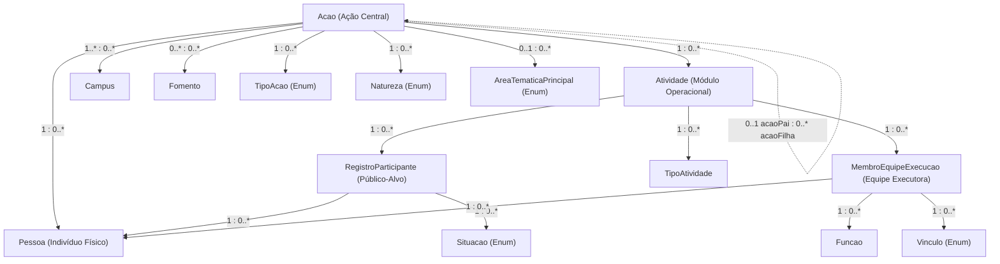

# Dicionário de Dados: Modelo de Classes SRC (Sistema de Registro e Emissão de Certificados)

**Arquivo de Referência:** `Adito/Docs/ModelosClasses/ModeloClassesSRC.asta` (Diagrama de Classes UML `Diagrama de Classes - SRC`)  
**Bases de Origem Analisadas:**
* Extração pública de ações: `src/data/serra/acao_*.json` e `src/data/serra/_index.json`
* Extração autenticada de participações (público-alvo e equipe): `src/data/participacoes/participacoes_*.json`
* Módulos de engenharia e regras de negócio: `src/src/src_etl/etl/models.py`, `detail.py`, `gerenciar.py`, `consolidar.py`, `enriquecer.py` e `vinculadas.py`
* Painel analítico e consolidação FORPROEX: `src/src/src_etl/dashboard/`

**Padrão:** Senior Data Architecture & ETL Documentation Standards  
**Última Atualização:** 2026-11-11  
**Status:** Auditado via Astah API e validado minuciosamente contra o modelo `.asta` e mais de 200 ações reais e 9.100 participações extraídas do SRC do Ifes.

---

## 1. Visão Geral da Arquitetura do Modelo SRC

O modelo `ModeloClassesSRC.asta` organiza as ações extensionistas, pedagógicas e técnico-científicas gerenciadas pelo **SRC/Ifes** (Sistema de Registro e Emissão de Certificados). A arquitetura modela o ciclo de vida completo das ações: desde sua submissão formal protocolada, vinculação institucional a campi e fontes de fomento orçamentário, até o desdobramento operacional em atividades específicas e a respectiva atuação de equipes de execução e atendimento de público-alvo certificado.

O modelo está estruturado em **9 classes conceituais**, **5 tipos enumerados (enums)** e **16 associações relacionais**:

---

## 2. Dicionário Detalhado por Classe

---

### 2.1 Classe: `Acao`

Representa a iniciativa central de extensão, ensino ou pesquisa registrada no SRC (programa, projeto, curso, evento ou prestação de serviços). É a entidade em torno da qual orbitam os processos administrativos, os relatórios de execução, os recursos de fomento e as atividades executadas.

| Nome do Atributo | Tipo | Multiplicidade | Coluna Original | Significado | Exemplo Real |
| :--- | :---: | :---: | :--- | :--- | :--- |
| **`id`** | `Integer` | `1` | `acao_id` (parâmetro da URL `detalha-acao.xhtml?acao=<id>`) | Identificador numérico interno e exclusivo atribuído à ação pelo motor JSF/banco relacional do SRC. Funciona como chave primária natural de extração web. | `4820`, `466`, `3140`, `1939` |
| **`processo`** | `String` | `1` | `Processo nº` | Número oficial de autuação do processo administrativo formal no protocolo/SIPAC do Ifes sob o qual a proposta tramitou e foi autorizada. | `"23158.003498/2023-79"`, `"23158.000372/2015-32"`, `"23158.002622/2025-41"` |
| **`titulo`** | `String` | `1` | `Título ação` | Título oficial completo da ação, tal como aprovado no edital e registrado pelo coordenador no cadastro inicial do SRC. | `"Mulheres Mil – Eletricista Instalador Predial em Baixa Tensão"`, `"Projeto Conhecer"`, `"Robótica Educacional na Escola Pública"` |
| **`dataCadastro`** | `Date` | `1` | `Data de cadastro` | Data civil em que a ação foi registrada e submetida pela primeira vez no sistema SRC (extraída no padrão `DD/MM/AAAA` e convertida para o tipo temporal `Date`). | `2023-12-07` (de `"07/12/2023"`), `2015-07-06` (de `"06/07/2015"`) |
| **`relatorioAprovado`** | `Boolean` | `1` | `Relatório aprovado` | Sinalizador booleano que expressa se a prestação de contas e o relatório final de execução técnica da ação foram formalmente homologados pela Diretoria de Extensão (`"Sim"` $\rightarrow$ `true`, `"Não"` $\rightarrow$ `false`). | `true` (para `"Sim"`), `false` (para `"Não"`) |
| **`urlDetalhe`** | `String` | `1` | `url_detalhe` (gerado na extração) | Endereço web canônico e direto para visualização pública dos detalhes cadastrais completos da ação no portal do SRC. | `"https://src.ifes.edu.br/src/public/detalha-acao.xhtml?acao=4820"` |

#### Associações da Classe `Acao`:
* **`coordena` $\rightarrow$ `Pessoa [1]`:** Cada ação possui obrigatoriamente exatamente um coordenador geral responsável (extraído do campo `"Coordenador(a)"`).
* **`possui` $\rightarrow$ `Campus [1..*]`:** A ação pertence formalmente a um ou mais campi do Ifes responsáveis por sua execução (extraído do campo `"Campus"`).
* **`? do tipo` $\rightarrow$ `TipoAcao [1]`:** Classificação tipológica da ação segundo as normas do MEC/FORPROEX (extraído do campo `"Tipo ação"`).
* **`possui` $\rightarrow$ `Natureza [1]`:** Eixo acadêmico fundamental da ação perante o tripé universitário (extraído do campo `"Natureza"`).
* **`financia` $\rightarrow$ `Fomento [0..*]`:** Programa, edital ou mecanismo orçamentário que provê recursos de custeio/bolsas para a ação (extraído do campo `"Fomento"`).
* **`possui` $\rightarrow$ `AreaTematicaPrincipal [0..1]`:** Macro-área de extensão universitária preconizada pelo FORPROEX (extraído do campo `"Área temática principal"`).
* **`vinculada a` $\rightarrow$ `Acao [0..1] (acaoPai)` / `[0..*] (acaoFilha)`:** Auto-associação que mapeia a hierarquia de programas e ações derivadas (projetos, cursos ou eventos matriciais vinculados a um programa-mãe; vindo do campo `"Ação vinculante"` e da rota `consulta-acao-vinculada.xhtml`).
* **`composta por` $\rightarrow$ `Atividade [0..*]`:** Uma ação agrega operacionalmente zero ou mais atividades programadas.

---

### 2.2 Classe: `Atividade`

Representa o módulo operacional, pedagógico ou cronológico concreto dentro de uma ação (uma turma de curso, um módulo formativo, uma oficina, palestra ou subprojeto). No SRC, o controle fino de frequência, emissão de certificados, alocação de equipe e atendimento ao público-alvo ocorre no nível de atividade.

| Nome do Atributo | Tipo | Multiplicidade | Coluna Original | Significado | Exemplo Real |
| :--- | :---: | :---: | :--- | :--- | :--- |
| **`id`** | `Integer` | `1` | `atividade_id` (onclick do botão `Público-Alvo` em `dtblAtividades`) | Identificador primário numérico único da atividade no ecossistema do SRC, utilizado pelas rotas de gestão de participantes. | `2101`, `1834`, `4091`, `3553` |
| **`nome`** | `String` | `1` | Coluna `Atividade` (em `dtblAtividades`) | Denominação ou título descritivo da atividade específica que compõe o plano de trabalho da ação. | `"ELETRICISTA INSTALADOR PREDIAL DE BAIXA TENSÃO"`, `"GDE: Gestão de Tipos Documentais do IFES"`, `"Oficina de Soldagem Eletrônica"` |

#### Associações da Classe `Atividade`:
* **`composta por` $\rightarrow$ `Acao [1]`:** A atividade pertence a exatamente uma ação-mãe estruturante.
* **`? do tipo` $\rightarrow$ `TipoAtividade [1]`:** Modalidade da atividade (Curso, Evento, Projeto, etc.), extraída da coluna `Tipo` de `dtblAtividades`.
* **`participa` $\rightarrow$ `RegistroParticipante [0..*]`:** Relação com as pessoas inscritas atendidas pela atividade na condição de público-alvo.
* **`atua em` $\rightarrow$ `MembroEquipeExecucao [0..*]`:** Relação com os docentes, técnicos, alunos e parceiros alocados na equipe de execução da atividade.

---

### 2.3 Classe: `RegistroParticipante`

Classe associativa/de histórico que documenta o ingresso, desempenho, assiduidade e situação de certificação de um participante atendido na condição de público-alvo (aluno ou cidadão da comunidade externa) em uma atividade.

| Nome do Atributo | Tipo | Multiplicidade | Coluna Original | Significado | Exemplo Real |
| :--- | :---: | :---: | :--- | :--- | :--- |
| **`cargaHoraria`** | `Float` | `1` | `C.H` (em `dtblParticipacoes` de `gerenciar-publico-alvo.xhtml`) | Volume total de horas curriculares cumpridas pelo participante na atividade, computadas para comprovação formativa e certificação. | `160.0` (de `"160"`), `40.0` (de `"40"`), `80.0` (de `"80"`), `20.0` (de `"20"`) |
| **`certificado`** | `Boolean` | `1` | `Certificado` (em `dtblParticipacoes` de `gerenciar-publico-alvo.xhtml`) | Indicador booleano que registra se o certificado oficial de conclusão foi emitido com sucesso para o aluno (`"SIM"` $\rightarrow$ `true`, `"NÃO"` $\rightarrow$ `false`). | `true` (para `"SIM"`), `false` (para `"NÃO"`) |
| **`dataInicio`** | `Date` | `1` | `Início` (em `dtblParticipacoes` de `gerenciar-publico-alvo.xhtml`) | Data de início do período letivo/formativo cursado pelo participante na referida atividade (convertida de `DD/MM/AAAA`). | `2023-03-04` (de `"04/03/2023"`), `2016-01-01` (de `"01/01/2016"`) |
| **`dataTermino`** | `Date` | `1` | `Término` (em `dtblParticipacoes` de `gerenciar-publico-alvo.xhtml`) | Data de conclusão, encerramento ou desligamento da participação do aluno na atividade (convertida de `DD/MM/AAAA`). | `2023-12-12` (de `"12/12/2023"`), `2017-04-17` (de `"17/04/2017"`) |

#### Associações da Classe `RegistroParticipante`:
* **`participa como` $\rightarrow$ `Pessoa [1]`:** Indivíduo físico titular deste registro de frequência e certificação.
* **`participa` $\rightarrow$ `Atividade [1]`:** Atividade ofertada na qual o indivíduo participou como aluno/ouvinte.
* **`situação` $\rightarrow$ `Situacao [1]`:** Situação acadêmica formal do aluno no fechamento da atividade (extraída da coluna `"Situação"`: `APROVADO`, `CURSANDO` ou `REPROVADO`).

---

### 2.4 Classe: `MembroEquipeExecucao`

Representa o vínculo funcional e temporal de um indivíduo (servidor docente, técnico-administrativo, discente ou colaborador externo) alocado na equipe técnica executora de uma atividade específica.

| Nome do Atributo | Tipo | Multiplicidade | Coluna Original | Significado | Exemplo Real |
| :--- | :---: | :---: | :--- | :--- | :--- |
| **`dataInicio`** | `Date` | `1` | `Início` (em `dtblParticipacoes` de `gerenciar-equipe-execucao.xhtml`) | Data civil a partir da qual o membro começou a atuar formalmente na execução das tarefas da atividade. | `2017-03-08` (de `"08/03/2017"`), `2016-10-18` (de `"18/10/2016"`) |
| **`dataTermino`** | `Date` | `1` | `Término` (em `dtblParticipacoes` de `gerenciar-equipe-execucao.xhtml`) | Data civil de conclusão ou desligamento das atribuições operacionais do membro na atividade. | `2017-04-17` (de `"17/04/2017"`), `2016-06-15` (de `"15/06/2016"`) |

#### Associações da Classe `MembroEquipeExecucao`:
* **`participa como` $\rightarrow$ `Pessoa [1]`:** Pessoa física que compõe o quadro de execução.
* **`atua em` $\rightarrow$ `Atividade [1]`:** Atividade executada pela referida equipe.
* **`desempenha` $\rightarrow$ `Funcao [1]`:** Papel executivo desempenhado pelo participante na atividade (extraído da coluna `"Função"`: `COORDENADOR(A)`, `ALUNO(A) VOLUNTARIO`, `COLABORADOR(A)`, etc.).
* **`possui` $\rightarrow$ `Vinculo [1]`:** Vínculo institucional formal mantido pelo membro perante o Ifes (extraído da coluna `"Vínculo"`: `Aluno`, `Servidor`, `Convidado`).

---

### 2.5 Classe: `Pessoa`

Entidade canônica que unifica os indivíduos físicos participantes do SRC. Representa tanto os líderes/coordenadores de ações quanto os instrutores e colaboradores da equipe executora e os discentes/cidadãos atendidos no público-alvo.

| Nome do Atributo | Tipo | Multiplicidade | Coluna Original | Significado | Exemplo Real |
| :--- | :---: | :---: | :--- | :--- | :--- |
| **`id`** | `Integer` | `1` | Chave sintética gerada pelo modelo / hash de identificação ETL | Identificador primário numérico único da pessoa no banco unificado. Como o SRC não expõe uma chave de pessoa nativa, o ETL unifica por CPF/e-mail/nome. | `1`, `42`, `1058`, `7324` |
| **`nome`** | `String` | `1` | `Nome` (em equipe/público-alvo) e `Coordenador(a)` (no detalhe da ação) | Nome civil completo e oficial do indivíduo cadastrado na base de dados do SRC. Chave textual mestra para conciliação com SigPesq e Lattes.  🔒 **Privacidade (LGPD):** Todos os nomes de pessoas físicas (coordenadores, membros de equipe e discentes/participantes atendidos) são desidentificados nos dicionários e relatórios analíticos. | `"Servidor Docente A (Coordenação)"` *(anonimizado)*, `"Servidor Docente B (Coordenação)"` *(anonimizado)*, `"Participante Aluno A"` *(anonimizado)*, `"Discente Bolsista B"` *(anonimizado)* |
| **`cpf`** | `String` | `1` | `CPF` (em `dtblParticipacoes` de público-alvo e equipe) | Cadastro de Pessoa Física da Receita Federal do Brasil (11 dígitos formatados com máscara ou dígitos limpos). Chave inequívoca para cruzamento inter-bases.  🔒 **Privacidade (LGPD):** Dado altamente confidencial; deve ser armazenado como hash criptográfico ou exibido estritamente com máscara de anonimização. | `"***.380.657-**"`, `"***.476.677-**"`, `"***.456.789-**"` *(máscaras de proteção LGPD)* |
| **`email`** | `String` | `1` | `E-mail` (em `dtblParticipacoes` de público-alvo e equipe) | Endereço eletrônico de contato registrado no ato da inscrição ou vínculo.  🔒 **Privacidade (LGPD):** E-mails pessoais e funcionais de pessoas físicas são protegidos por máscara para evitar exposição. | `"participante***@email.com"`, `"aluno***@gmail.com"`, `"servidor***@ifes.edu.br"` *(anonimizado)* |
| **`dataNasc`** | `Date` | `1` | `Nasc.` (em `dtblParticipacoes` de `gerenciar-publico-alvo.xhtml`) | Data de nascimento da pessoa física, coletada na ficha de inscrição dos participantes atendidos no público-alvo.  🔒 **Privacidade (LGPD):** Dado sensível; apresentado exclusivamente de forma truncada/mascarada. | `"1995-**-**"`, `"2002-**-**"` *(ano com mês e dia mascarados para preservação da privacidade)* |

#### Associações da Classe `Pessoa`:
* **`coordena` $\rightarrow$ `Acao [0..*]`:** Ações institucionais cuja coordenação geral é exercida pela referida pessoa.
* **`participa como` $\rightarrow$ `RegistroParticipante [0..*]`:** Histórico de participações da pessoa como aluna ou participante de público-alvo.
* **`participa como` $\rightarrow$ `MembroEquipeExecucao [0..*]`:** Histórico de atuações da pessoa como integrante operacional da equipe executora.

---

### 2.6 Classe: `Campus`

Representa a unidade territorial e administrativa do Instituto Federal do Espírito Santo (campus) onde a ação foi originada, aprovada e executada.

| Nome do Atributo | Tipo | Multiplicidade | Coluna Original | Significado | Exemplo Real |
| :--- | :---: | :---: | :--- | :--- | :--- |
| **`id`** | `Integer` | `1` | Chave sintética gerada pelo modelo | Identificador primário numérico do campus no catálogo institucional. | `1`, `2`, `14` |
| **`nome`** | `String` | `1` | `Campus` / `campus` (dropdown da consulta e campo no detalhe) | Denominação oficial do campus do Ifes mantenedor da ação. | `"Serra"`, `"Vitória"`, `"Vila Velha"`, `"Cariacica"`, `"Colatina"` |

#### Associações da Classe `Campus`:
* **`possui` $\rightarrow$ `Acao [0..*]`:** Conjunto de ações de extensão e ensino sediadas ou promovidas pelo campus.

---

### 2.7 Classe: `Fomento`

Representa a fonte de recursos, programa de bolsas, edital de fomento ou convênio orçamentário que financia a execução da ação extensionista.

| Nome do Atributo | Tipo | Multiplicidade | Coluna Original | Significado | Exemplo Real |
| :--- | :---: | :---: | :--- | :--- | :--- |
| **`id`** | `Integer` | `1` | Chave sintética gerada pelo modelo | Identificador primário numérico da entidade de fomento orçamentário. | `1`, `2`, `3` |
| **`nome`** | `String` | `1` | `Fomento` (painel de detalhe da ação) | Nome institucional do programa ou modalidade de fomento financeiro. Quando a ação não dispõe de dotação orçamentária ou bolsas externas, o SRC registra expressamente `"SEM VÍNCULO"`. | `"PAEX-IFES"`, `"SEM VÍNCULO"`, `"MULHERES MIL"`, `"FAPES"`, `"PRONATEC"`, `"SETEC"` |

#### Associações da Classe `Fomento`:
* **`financia` $\rightarrow$ `Acao [0..*]`:** Ações que receberam recursos ou bolsas dessa rubrica de fomento.

---

### 2.8 Classe: `TipoAtividade`

Catálogo que tipifica a natureza pedagógica ou operacional de uma atividade interna da ação.

| Nome do Atributo | Tipo | Multiplicidade | Coluna Original | Significado | Exemplo Real |
| :--- | :---: | :---: | :--- | :--- | :--- |
| **`id`** | `Integer` | `1` | Chave sintética gerada pelo modelo | Identificador primário numérico do tipo de atividade. | `1`, `2`, `3` |
| **`nome`** | `String` | `1` | Coluna `Tipo` da tabela `dtblAtividades` | Classificação da modalidade de entrega da atividade. | `"Evento"`, `"Projeto"`, `"Curso"`, `"Programa"`, `"Prestação de Serviço"`, `"Produto"` |

#### Associações da Classe `TipoAtividade`:
* **`? do tipo` $\rightarrow$ `Atividade [0..*]`:** Atividades vinculadas a este respectivo tipo.

---

### 2.9 Classe: `Funcao`

Catálogo dos papéis operacionais, técnicos e gerenciais que um membro da equipe executora pode assumir em uma atividade.

| Nome do Atributo | Tipo | Multiplicidade | Coluna Original | Significado | Exemplo Real |
| :--- | :---: | :---: | :--- | :--- | :--- |
| **`id`** | `Integer` | `1` | Chave sintética gerada pelo modelo | Identificador primário numérico da função executiva. | `1`, `2`, `3` |
| **`nome`** | `String` | `1` | Coluna `Função` em `dtblParticipacoes` (equipe de execução) | Título ou designação do encargo formal desempenhado pelo colaborador na atividade. | `"COORDENADOR(A)"`, `"COLABORADOR(A)"`, `"ALUNO(A) VOLUNTARIO"`, `"ALUNO(A) BOLSISTA"`, `"INSTRUTOR(A)"`, `"ORGANIZADOR(A)"`, `"PALESTRANTE"`, `"MONITOR(A)"`, `"PROFESSOR(A)"`, `"APOIO TÉCNICO"` |

#### Associações da Classe `Funcao`:
* **`desempenha` $\rightarrow$ `MembroEquipeExecucao [0..*]`:** Registros de alocação de equipe em que essa atribuição foi desempenhada.

---

## 3. Tipos Enumerados (Enums de Domínio)

---

### 3.1 Enum: `TipoAcao`

Classifica a modalidade institucional estruturante da ação perante a Política Nacional de Extensão Universitária.

* **Coluna Original no SRC:** `Tipo ação`
* **Local de Extração:** Formulário do painel de detalhe da ação (`td.ui-panelgrid-cell`).

| Valor Enumerado (Literal) | Significado Semântico de Negócio | Frequência Relativa / Observações no SRC | Exemplos Reais Concretos |
| :--- | :--- | :--- | :--- |
| **`Projeto`** | Ação processual e contínua de caráter educativo, social, cultural ou científico, com objetivos e metas delimitados no tempo. | Mais frequente na base (~43% das ações). | `"GDE: Gestão de Tipos Documentais do IFES"`, `"Robótica Educacional na Escola Pública"` |
| **`Curso`** | Ação pedagógica planejada com ementa, cronograma e carga horária definida, voltada à disseminação de conhecimentos para o público-alvo. | Segunda tipologia mais frequente (~29% das ações). | `"Mulheres Mil – Eletricista Instalador Predial em Baixa Tensão"`, `"Introdução à Programação Python"` |
| **`Evento`** | Ação pontual de interesse comunitário, acadêmico ou cultural (seminários, jornadas, palestras, congressos, mostras tecnológicas). | Terceira tipologia mais frequente (~16% das ações). | `"Projeto Conhecer"`, `"Semana Nacional de Ciência e Tecnologia"` |
| **`Programa`** | Conjunto articulado de projetos e outras ações (cursos, eventos), preferencialmente de caráter multidisciplinar e integração curricular. | Ações matriciais estruturantes (~11% das ações). | `"Programa Mulheres Mil"`, `"Programa de Formação de Professores da Rede Básica"` |
| **`Prestação de Serviço`** | Realização de ensaios laboratoriais, consultorias, assessorias técnicas, análises periciais ou produção técnica direcionada a terceiros. | Ocorrência pontual vinculada a contratos e parcerias. | `"Consultoria Técnica para Eficiência Energética Industrial"` |
| **`Programa em Rede`** | Programa colaborativo institucional intercampi ou com participação de múltiplas instituições da Rede Federal. | Raridade cadastral para programas de cooperação ampla. | `"Programa de Inovação em Rede Ifes/MEC"` |

---

### 3.2 Enum: `Natureza`

Identifica a dimensão acadêmica primordial da ação dentro do tripé indissociável Ensino-Pesquisa-Extensão.

* **Coluna Original no SRC:** `Natureza`
* **Local de Extração:** Formulário de detalhe da ação.

| Valor Enumerado (Literal) | Significado Semântico de Negócio | Frequência Relativa / Observações no SRC | Exemplos Reais Concretos |
| :--- | :--- | :--- | :--- |
| **`Extensão`** | Ação formal de interação dialógica transformadora entre o Ifes e a sociedade capixaba, transferindo e cocriando saberes. | Maioria na base de extensão (~54% das ações). | `"Mulheres Mil – Eletricista Instalador"`, `"Projeto Conhecer"` |
| **`Ensino`** | Ações de apoio pedagógico, nivelamento escolar, cursos de aperfeiçoamento e reforço curricular para a comunidade discente. | Segunda maior representatividade (~43% das ações registradas no SRC). | `"Nivelamento de Matemática Básica"`, `"Apoio Pedagógico em Física"` |
| **`Pesquisa`** | Ações associadas a projetos de iniciação científica ou difusão de metodologias de pesquisa com registro no SRC. | Ocorrência pontual (~2% das ações; a maioria reside no SigPesq). | `"Metodologia Científica Aplicada a Projetos Tecnológicos"` |
| **`Desenv. Institucional`** | Ações internas voltadas ao fortalecimento institucional, planejamento estratégico e modernização administrativa do Ifes. | Casos específicos de qualificação interna (~1% das ações). | `"Capacitação de Servidores em Processo Eletrônico"` |

---

### 3.3 Enum: `AreaTematicaPrincipal`

Define a macro-área do conhecimento social e prático segundo as 8 áreas oficiais do **FORPROEX** (Fórum de Pró-Reitores de Extensão das Instituições Públicas de Educação Superior Brasileiras).

* **Coluna Original no SRC:** `Área temática principal`
* **Local de Extração:** Formulário de detalhe da ação.
* **Nota sobre a Modelagem Astah:** No diagrama `.asta`, a classe `AreaTematicaPrincipal` possui o estereótipo `«enumeration»`, mas foi desenhada com um atributo auxiliar gráfico `attribute6 : int [1]`. Trata-se de um artefato visual da ferramenta de modelagem; conceitualmente ela atua estritamente como enumeração de domínio fechado. Quando este campo vem vazio no portal do SRC, a suíte de ETL (`src-etl-enrich`) deduz e infere a área temática via IA (Mistral) a partir do Título e Resumo da proposta.

| Valor Enumerado (Literal) | Significado Semântico de Negócio (Diretriz FORPROEX) | Exemplos Reais Concretos no Ifes |
| :--- | :--- | :--- |
| **`Tecnologia e Produção`** | Desenvolvimento e difusão de novas tecnologias, inovação produtiva, automação, engenharia aplicada, sistemas de informação e indústria sustentável. | `"Mulheres Mil – Eletricista Instalador Predial"`, `"Desenvolvimento de Software Livre"` |
| **`Educação`** | Metodologias de ensino-aprendizagem, formação continuada de professores da rede pública, alfabetização, letramento e educação inclusiva. | `"Robótica Educacional para Escolas Públicas"`, `"Capacitação Docente em Tecnologias Educacionais"` |
| **`Cultura`** | Expressões artísticas, difusão musical, teatro, salvaguarda do patrimônio imaterial, história capixaba e memória cultural. | `"Mostra de Música Popular do Ifes"`, `"Oficinas de Patrimônio Cultural e Arte Urbana"` |
| **`Saúde`** | Promoção da qualidade de vida, segurança ocupacional, saúde preventiva e atenção a comunidades vulneráveis. | `"Prevenção de Lesões em Esportes Amadores"`, `"Boas Práticas de Higiene e Nutrição Familiar"` |
| **`Meio Ambiente`** | Educação ambiental, sustentabilidade ecológica, gestão hídrica, conservação da biodiversidade e reciclagem. | `"Reciclagem de Resíduos Eletrônicos no Campus"`, `"Horta Urbana Comunitária Sustentável"` |
| **`Trabalho`** | Empreendedorismo solidário, formação profissionalizante, inserção no mercado de trabalho e economia cooperativa. | `"Oficina de Planejamento de Carreira e Empreendedorismo"`, `"Economia Solidária e Geração de Renda"` |
| **`Comunicação`** | Mídias comunitárias, democratização do acesso à informação, divulgação científica e jornalismo comunitário. | `"Rádio Universitária Comunitária"`, `"Boletim Informativo de Ciência e Tecnologia"` |
| **`Direitos Humanos e Justiça`** | Defesa de direitos civis, igualdade racial e de gênero, direitos da criança e adolescente, cidadania e assistência jurídica popular. | `"Ciclo de Palestras sobre Direitos Humanos e Cidadania"`, `"Inclusão e Acessibilidade no Ensino Técnico"` |

---

### 3.4 Enum: `Situacao`

Registra a situação formal de matrícula e avaliação acadêmica final ou em andamento do participante atendido no público-alvo da atividade.

* **Coluna Original no SRC:** `Situação`
* **Local de Extração:** Tabela `dtblParticipacoes` na interface `gerenciar-publico-alvo.xhtml`.

| Valor Enumerado (Literal) | Significado Semântico de Negócio | Frequência Relativa na Base Real | Exemplos Reais Concretos |
| :--- | :--- | :--- | :--- |
| **`APROVADO`** | O discente atingiu plenamente a frequência mínima regulamentar (geralmente $\ge 75\%$) e as notas de aproveitamento exigidas, estando apto à certificação oficial. | Ampla maioria das conclusões (> 91% do público-alvo registrado). | `"Participante A"` (160h, Certificado: SIM) `"Participante B"` (160h, Certificado: SIM) |
| **`CURSANDO`** | O discente encontrava-se com matrícula ativa e participando regularmente dos encontros na data de realização do scrape/fechamento do relatório. | Casos de turmas e módulos plurianuais em andamento (~6% da base). | `"Participante C"` (160h, Certificado: NÃO, Situação: CURSANDO) |
| **`REPROVADO`** | O discente não alcançou a frequência mínima estabelecida ou não concluiu as avaliações pedagógicas obrigatórias, não fazendo jus a certificado. | Ocorrências pontuais de evasão ou insuficiência de frequência (~2% da base). | `"Participante D"` (0h ou carga parcial sem certificação, Situação: REPROVADO) |

---

### 3.5 Enum: `Vinculo`

Caracteriza a categoria do relacionamento funcional, estudantil ou externo mantido pelo membro da equipe executora perante o Ifes.

* **Coluna Original no SRC:** `Vínculo`
* **Local de Extração:** Tabela `dtblParticipacoes` na interface `gerenciar-equipe-execucao.xhtml`.

| Valor Enumerado (Literal) | Significado Semântico de Negócio | Frequência Relativa na Base Real | Exemplos Reais Concretos |
| :--- | :--- | :--- | :--- |
| **`Aluno`** | Discente regularmente matriculado em curso técnico, de graduação ou pós-graduação do Ifes que atua na execução da ação (como voluntário, bolsista ou estagiário). | Categoria mais numerosa da equipe (~52% dos membros). | `"Discente Voluntário A"` (Aluno Voluntário) `"Discente Bolsista B"` (Aluno Bolsista) |
| **`Servidor`** | Integrante do quadro funcional permanente ou temporário do Ifes (professor do magistério EBTT ou técnico-administrativo em educação - TAE). | Núcleo coordenador e de instrutoria (~37% dos membros). | Servidor Docente (ex.: Coordenador de Ação) Servidor Técnico-Administrativo (ex.: Colaborador Técnico) |
| **`Convidado`** | Profissional, instrutor voluntário, liderança comunitária ou pesquisador externo parceiro sem vínculo contratual direto com o Ifes. | Colaboradores externos e convidados especiais (~11% dos membros). | Palestrante convidado de empresa parceira ou docente de universidade externa. |

---

## 4. Matriz de Relacionamentos e Associações UML

A tabela abaixo sintetiza todas as 16 associações presentes no arquivo `ModeloClassesSRC.asta`, explicitando as entidades de extremidade, multiplicidades nos dois sentidos, nomes das associações e os papéis semânticos assumidos:

| Associação | Entidade Origem | Multiplicidade Origem | Entidade Destino | Multiplicidade Destino | Papel de Origem / Destino | Regra de Negócio e Descrição Semântica |
| :--- | :--- | :---: | :--- | :---: | :--- | :--- |
| **`coordena`** | `Acao` | `0..*` | `Pessoa` | `1` | ação / coordenador | Toda ação possui exatamente 1 coordenador geral (vencendo inconsistências via extração da coluna `Coordenador(a)`). |
| **`possui`** | `Acao` | `0..*` | `Campus` | `1..*` | ação / campus | A ação pertence e é promovida por pelo menos 1 campus (podendo envolver múltiplos campi em programas em rede). |
| **`? do tipo`** | `Acao` | `0..*` | `TipoAcao` | `1` | ação / tipologia | Toda ação classifica-se estritamente em um tipo oficial (Projeto, Curso, Evento, etc.). |
| **`possui`** | `Acao` | `0..*` | `Natureza` | `1` | ação / natureza | Toda ação define seu eixo acadêmico essencial (Extensão, Ensino, Pesquisa). |
| **`financia`** | `Acao` | `0..*` | `Fomento` | `0..*` | ação / fomento | Relação $N:N$: uma ação pode não ter recursos (`SEM VÍNCULO`) ou usufruir de múltiplos editais; um fomento apoia diversas ações. |
| **`possui`** | `Acao` | `0..*` | `AreaTematicaPrincipal` | `0..1` | ação / área temática | A ação possui no máximo uma macro-área temática FORPROEX principal declarada (pode ser inferida se nula). |
| **`vinculada a`** | `Acao` (Filha) | `0..*` | `Acao` (Pai) | `0..1` | `acaoFilha` / `acaoPai` | Auto-associação hierárquica: ações filhas vinculadas a um programa matricial comum guarda-chuva. |
| **`composta por`** | `Acao` | `1` | `Atividade` | `0..*` | ação mãe / atividade filha | Composição estruturante: uma ação agrega zero ou mais atividades executadas em seu cronograma. |
| **`? do tipo`** | `Atividade` | `0..*` | `TipoAtividade` | `1` | atividade / tipo atividade | Cada atividade operacional possui um tipo cadastrado (Curso, Evento, Projeto, etc.). |
| **`participa`** | `Atividade` | `1` | `RegistroParticipante` | `0..*` | atividade / participante | Agregação de discentes atendidos no público-alvo de uma dada atividade. |
| **`atua em`** | `Atividade` | `1` | `MembroEquipeExecucao` | `0..*` | atividade / executor | Alocação da equipe técnica de execução responsável por ministrar e gerir a atividade. |
| **`participa como`** | `RegistroParticipante` | `0..*` | `Pessoa` | `1` | histórico / pessoa física | Liga o histórico individual de frequência e nota à pessoa física cadastrada. |
| **`situação`** | `RegistroParticipante` | `0..*` | `Situacao` | `1` | registro / situação | Classifica o desfecho acadêmico do aluno na atividade (`APROVADO`, `CURSANDO`, `REPROVADO`). |
| **`participa como`** | `MembroEquipeExecucao` | `0..*` | `Pessoa` | `1` | histórico / pessoa física | Conecta a atuação profissional na equipe de execução ao cadastro da pessoa. |
| **`desempenha`** | `MembroEquipeExecucao` | `0..*` | `Funcao` | `1` | membro / encargo | Papel exercido pelo membro na equipe da atividade (`COORDENADOR`, `BOLSISTA`, etc.). |
| **`possui`** | `MembroEquipeExecucao` | `0..*` | `Vinculo` | `1` | membro / vínculo institucional | Condição de vinculação institucional perante o Ifes (`Aluno`, `Servidor`, `Convidado`). |

---

## 5. Mapeamento de Cruzamento e Integração Inter-Bases

Conforme estabelecido no relatório de governança arquitetural (`Adito/Docs/ModelosClasses/PossiveisPontosIntegracao.md`), as quatro bases institucionais (SigPesq, Lattes, CNPq DGP e SRC) articulam-se prioritariamente em torno de **Pessoas**, **Iniciativas** e **Campus**. O modelo SRC contribui de maneira singular com o vértice da **Extensão e Ensino**, enriquecendo o perfil dos pesquisadores do Ifes:

1. **Resolução de Entidade `Pessoa` (Chave Mestra de Integração):**
   * **No SRC:** `Pessoa.cpf` e `Pessoa.email` (presentes na coleta de participações e equipes).
   * **No SigPesq:** `OrientadoCpf` e `EmailCoordenador` / `OrientadorEmail`.
   * **No Lattes:** `PESSOA.id_lattes` (e hash de CPF/e-mail obtido no crawler de currículos).
   * **Eficácia Real Comprovada:** O cruzamento das bases já identificou **65 de 71 coordenadores do SRC** diretamente mapeados na base de pesquisa SigPesq/Lattes.

2. **Cruzamento de Iniciativas (`Acao` $\leftrightarrow$ `ProjetoPesquisa` / `PROJETO`):**
   * Ações do SRC que possuem natureza `"Pesquisa"` ou interface direta com inovação conectam-se aos projetos do Lattes/SigPesq via correspondência fonética/fuzzy de `Acao.titulo` e `PROJETO.nome`.
   * Conforme diretriz do projeto, as iniciativas não devem ser fundidas, mas sim interligadas por relacionamentos de correlação temática e co-autoria.

3. **Padronização Organizacional (`Campus` e `Fomento`):**
   * A entidade `Campus.nome` do SRC (`"Serra"`, `"Vitória"`, etc.) normaliza perfeitamente com a classe `Campus.nome_campus` do SigPesq e com o atributo `GRUPO_PESQUISA.unidade_campus` do espelho CNPq DGP.
   * A entidade `Fomento.nome` harmoniza rubricas de órgãos financiadores (ex: `FAPES`, `SETEC`, editais institucionais internos) com as classes `AgenciaFinanciamento` do SigPesq e `INSTITUICAO_FINANCIADORA` do Lattes.
